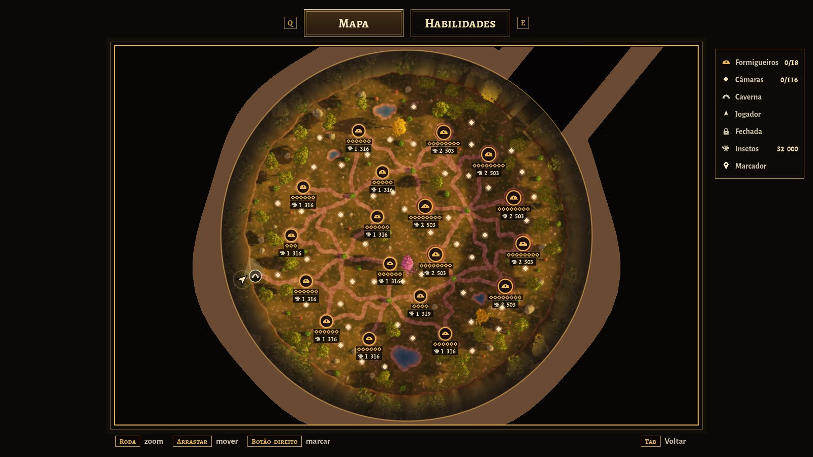

# Anteater Simulator

Um jogo **relaxante de "arrumar e limpar"**, inspirado em *Leaf it Alone* e
*Librarian: Tidy Up the Arcane Library*: você é um **tamanduá-bandeira** que
come formigas e cupins no **cerrado**, evolui habilidades e deixa a região
**100% limpa**. Não dá para perder, e o jogo tem fim. Para **PC (Steam)**, em
**3D estilizado** com cara de filme de animação, visto pelos olhos do tamanduá.
Feito em **Godot 4.7**.

**Tudo o que foi decidido sobre o jogo está em
[`docs/DESIGN.md`](docs/DESIGN.md)**: o documento de design, o plano de
produção, os protótipos e as decisões, num lugar só.


| | |
|---|---|
|  |  |
|  |  |
|  |  |
|  |  |
|  |  |

> Capturas feitas em um servidor sem placa de vídeo (renderização por software).
> No seu PC fica igual ou melhor.

---

## A demo jogável

Uma **clareira do cerrado no fim da tarde**, cercada por penhascos. O tamanduá
acorda numa **caverna**, vê lá longe um **cupinzeiro gigante** e a barriga
ronca: hora de comer. A colônia tem **32 000 insetos**, cada um andando
sozinho, e **18 formigueiros** espalhados pelo mapa inteiro. Um quarto anda em
fila pelas trilhas de terra, um quarto passeia pelo campo em volta das câmaras
espalhadas pelo mapa, e a metade mora nas **câmaras**, que você abre cavando.
Perto da caverna ficam os formigueiros pequenos; os 7 grandes, do lado da
saída, guardam uma **rainha** bem no fundo. **Cada 10 insetos comidos valem 1
ponto** e cada habilidade tem o seu preço. Com a clareira **100% limpa**, as garras quebram o
**tronco caído** que fecha a saída, e a demo termina.

A demo é a **primeira área** de um mapa maior, todo cercado por penhascos, que
leva até o cupinzeiro gigante; o plano está em
[`docs/DESIGN.md`](docs/DESIGN.md). A pesquisa sobre o ciclo das habilidades e a
economia da compra está em
[`docs/pesquisa-habilidades.md`](docs/pesquisa-habilidades.md).

### Como rodar

1. Instale o **Godot 4.7** (versão padrão, não precisa da .NET):
   <https://godotengine.org/download>
2. No Gerenciador de Projetos, clique em **Importar** e escolha o arquivo
   `project.godot` desta pasta.
3. Aperte **F5** (ou o botão ▶). Na primeira vez o Godot importa sons e
   texturas, o que leva alguns segundos.

O jogo abre em **tela cheia**; **F11** (ou Alt+Enter) alterna com a janela. O
projeto usa o renderizador **Forward+** (PC com placa de vídeo compatível com
Vulkan, Direct3D 12 ou Metal). Em **Configurações** dá para trocar o modo de
tela, a resolução e a qualidade gráfica.

### Controles

| Ação | Teclado e mouse | Controle |
|---|---|---|
| Andar | `W` `A` `S` `D` | analógico esquerdo |
| Olhar | mouse | analógico direito |
| Correr* | `Shift` | clicar o analógico esquerdo |
| **Lamber** | clique esquerdo (segure, com Lambida Contínua*) | `RT` |
| Farejar* | `Q` ou clique direito | `LT` |
| Cavar* (abrir câmara, quebrar o tronco) | segure `E` perto | `X` |
| Tremor* (pulo) | `Espaço` | `A` |
| Mapa, habilidades e estatísticas | `Tab` (o mapa abre primeiro; `Q` e `E` trocam a aba) | `Back` (`LB` e `RB` trocam a aba) |
| Marcar um ponto no mapa | clique direito no mapa | `Y` no mapa |
| Pausa | `Esc` | `Start` |
| Tela cheia | `F11` ou `Alt+Enter` | |

\* liberados pela árvore de habilidades. Todas as teclas podem ser trocadas em
Configurações → Controles, e Correr e Cavar podem ser "segurar" ou "apertar
uma vez".

### O que tem na demo hoje

- **Interface no estilo "Constelação"** (o mesmo da árvore de habilidades):
  painéis com moldura dourada, as formigas comidas num medalhão e as habilidades
  em círculos. A bússola é uma faixa com o rumo no meio; o formigueiro à sua
  frente mostra a distância e as câmaras dele (as verdes já estão limpas).
- **Pouco texto na tela:** conquistas viram **cartões** no canto direito (câmara
  limpa, formigueiro limpo, rainha, Frenesi, habilidade aprendida); as **dicas**
  são curtas, embaixo da mira, com a tecla num quadradinho ("E Abrir câmara");
  salvar é só um ícone girando. Em Configurações → Jogo, **Dicas** pode ser
  Todas, Poucas ou Nenhuma.
- **Mapa** (`Tab`): o mapa inteiro visto de cima, com a saída para cima e para
  a direita. A clareira fica colorida onde você já andou; as áreas 2, 3 e 4
  aparecem pretas, com cadeado. A roda do mouse aproxima e arrastar move. Mostra
  os formigueiros (limpos, começados ou não visitados), **quantos insetos
  faltam em cada formigueiro já visto**, as câmaras que você já viu, a caverna
  e você; passe o mouse num formigueiro para ver a área dele. Clique direito
  põe um **marcador**, que aparece na bússola com a distância.
- **Estatísticas** (botão na pausa, `Esc`, e na tela do fim): os números do jogo
  (insetos, formigueiros, câmaras, rainhas, maior combo, linguadas e acerto,
  distância andada...), as parciais do contra o relógio e os recordes de todos
  os jogos.
- **Contra o relógio:** ao começar um jogo novo, escolha Normal ou Contra o
  relógio. No relógio, um cronômetro fica no canto e cada 25% dos insetos marca
  um tempo parcial, comparado com o do seu recorde (verde mais rápido, vermelho
  mais lento). Pausa, mapa e habilidades param o relógio.
- **32 000 insetos, um a um:** nas trilhas elas vão e voltam do arbusto
  (muitas carregando folhas); no campo, saem das câmaras, dão uma volta e
  entram de novo. Cada uma foge sozinha quando você chega perto, e cada
  formiga comida conta 1. Uma em cada 16 000 usa um chapéu de Natal.
- **Câmaras:** os montinhos de terra clara nos formigueiros são câmaras
  fechadas, e 48 delas ficam sozinhas no meio do campo, espalhadas por igual (as formigas que
  passeiam em volta contam para o formigueiro dono da câmara). Com **Cavar**
  (Garras), segure `E` perto de uma para abri-la: as moradoras **saem
  correndo**, fogem quando você chega perto e depois voltam para casa. Até 40
  ficam à vista; as outras saem do túnel conforme você come. Depois de cavar,
  as garras descansam (25 s no começo). As câmaras grandes, de tampa mais
  escura, pedem **Cavar Fundo**.
- **Suba nos formigueiros:** lá de cima dá para ver dentro das câmaras abertas.
- **Rainha:** mora no fundo dos formigueiros grandes. Com a **Escavação Real**,
  cave o topo do monte: ele se desmancha inteiro e fica um buraco com a rainha
  andando devagar lá embaixo, junto com as moradoras das outras câmaras dele.
  Coma a corte e ela vale **200 formigas** (20 pontos).
- **Língua:** no começo ela é lenta (pouco mais de uma lambida por segundo) e
  vai reta até onde você mira, pegando até 10 formigas perto da ponta. A linha
  de Destreza a deixa mais rápida. Com **Língua Certeira**, ela vai sozinha atrás da formiga mais perto
  da mira (com um contorno verde suave); a **Mira Ampla** aumenta essa área.
- **Trilhas:** as formigas vão e voltam sem parar; só as que você come somem
  de vez.
- **Formigas fogem** quando você chega correndo: chegue andando e lamba de longe.
  Correndo também não dá para lamber, até aprender **Lamber Correndo**.
- **Faro:** primeiro só diz quantas formigas há por perto e a que distância
  está a mais perto. Com Precisão, mostra uma nuvem borrada onde elas estão e
  depois as formigas brilhando através do capim; o Faro de Câmara mostra as
  câmaras fechadas. Nos níveis altos, a bússola mostra quanto falta em cada
  formigueiro e onde estão as rainhas. A cor do faro (vermelha) pode ser trocada
  em Configurações → Jogo.
- **Tremor:** um pulo; ao cair, as formigas em volta ficam tontas.
- **Tanajuras** (douradas, voando, com um zumbido baixinho quando estão perto)
  ativam o **Frenesi**: língua mais rápida e mais longa por 6 s.
- **Progresso:** formigueiro limpo ganha flores, e um losango por formigueiro
  no canto da tela mostra quantos faltam.
- **Penhascos e caverna:** a clareira é cercada por penhascos de arenito (o fim
  do mapa). Você começa numa caverna no pé deles, e uma trilha de terra leva até
  o formigueiro mais perto. O cupinzeiro gigante aparece lá longe, por cima dos
  penhascos. É sempre o mesmo fim de tarde, e há quatro lagoas de enfeite, de
  formas irregulares. O alto
  dos penhascos é cheio de árvores, e depois da passagem para a próxima área
  uma rampa sobe para uma mata fechada.
- **Árvore de habilidades** (`Tab`, aba ao lado do mapa): uma constelação, com
  os ramos saindo do centro. Passe o mouse numa habilidade para ver o que ela
  faz (com os números de antes → depois) e clique para aprender; as aprendidas
  acendem em dourado. Ela não abre
  sozinha: um selo no canto (◆ 2 Tab) mostra quando já dá para aprender algo.
- **Fim da demo:** um tronco caído fecha a passagem para a próxima área. Com
  todas as formigas comidas, a bússola mostra a saída: segure `E` perto do
  tronco e as garras quebram o tronco.
- **Sem derrota.** O jogo **salva sozinho**, em até **3 jogos salvos**; na tela
  inicial, **Continuar** abre o mais recente e **Jogos salvos** mostra os três
  (dá para apagar um).

### Habilidades

| Habilidade | Níveis (preço em pontos) |
|---|---|
| **Língua** | Lambida Contínua (25: segurar para lamber), e depois três linhas: **Bocado** · Lambida (40: até 50 formigas por lambida) · Lambida Larga (75: até 150) · Lambida Gulosa (115: até 250) · Lambida Voraz (170: até 400); **Destreza** · Língua Comprida (70: alcance +50% e lambe 25% mais rápido) · Saliva Grudenta (100: raio maior e mais 25% de rapidez) · Língua Turbo (150: 2x mais rápido); **Mira** · Língua Certeira (30: a língua vai atrás da formiga mais perto da mira) · Mira Ampla (60: essa área 25% maior) |
| **Garras** | Cavar (35: câmaras pequenas; depois as garras descansam 25 s), e depois: **Força** · Garras Fortes (70) · Tremor (110: recarga de 21 s) · Terremoto (170); **Rapidez** · Garras Ágeis (50: descanso de 15 s) · Garras Incansáveis (95: 5 s) · Recarga do Tremor (130: 14 s) · Recarga Relâmpago (150: 7 s); **Fundura** · Cavar Fundo (60: câmaras grandes) · Escavação Real (120: desmancha o monte da rainha) |
| **Patas** | Corrida (30: +25%), e depois: **Velocidade** · Patas Ligeiras (80: mais 25%) · Galope Silencioso (130); **Agilidade** · Lamber Correndo (60) |
| **Faro** | Farejar (20), e depois: **Alcance** · Faro Atento (40: 16 m) · Faro Apurado (70: 24 m) · Faro Aguçado (110: 34 m) · Faro Lendário (160: 50 m); **Precisão** · Faro Preciso (45: nuvem) · Faro Nítido (85: formigas brilhando) · Faro de Câmara (100) |
| **Escalada + Cauda** | Escalada (300) · Cauda Preênsil (400): ainda não feitas (aparecem com cadeado) |

10 formigas comidas = 1 ponto (a rainha vale 20 pontos). As linhas de um ramo
não se excluem. Tudo o que dá para aprender no Cerrado soma 2755 pontos, e dá
para redistribuir os pontos de graça na árvore.

### Tela e gráficos

Em **Configurações**:

- **Tela:** janela, tela cheia ou tela cheia exclusiva; resolução (em tela
  cheia, ela muda só o 3D e a interface continua nítida); resolução do 3D (50 a
  100%); VSync; limite de FPS.
- **Gráficos:** um preset ajusta tudo de uma vez, ou ajuste item por item:
  sombras, capim, suavização (FXAA, MSAA ou TAA), sombra de contato (SSAO), luz
  rebatida (SSIL), neblina volumétrica e brilho do sol.
- **Jogo:** sensibilidade do mouse e do controle, inverter eixo Y, campo de
  visão, balanço da câmera, cor do faro, dicas (Todas, Poucas ou Nenhuma) e
  mostrar ou esconder a interface (HUD).
- **Controles:** trocar qualquer tecla; Correr e Cavar como "segurar" ou
  "apertar uma vez".
- **Áudio:** volume geral, música, efeitos e ambiente.

| Preset | O que muda |
|---|---|
| Baixa | menos capim, sombras curtas, sem SSAO, FXAA, resolução 3D a 80% |
| Média | SSAO, sombras médias, MSAA 2x (padrão com vídeo integrado) |
| Alta | capim denso, sombras longas (padrão com placa de vídeo dedicada) |
| Ultra | ainda mais capim, neblina volumétrica, SSIL, MSAA 4x |

---

## Modelos 3D gerados por IA

Tudo na demo funciona com modelos **feitos por código** (formas suaves,
pelagem, folhas recortadas). Para trocar por modelos gerados por IA no mesmo
estilo:

- **[`docs/prompts-ia.md`](docs/prompts-ia.md)**: guia de estilo, paleta e o
  prompt de cada modelo.
- **[`assets/models/LEIA-ME.md`](assets/models/LEIA-ME.md)**: nomes de arquivo
  e ajustes. Basta colocar o `.glb` em `assets/models/` que o jogo troca sozinho.

O **formigueiro** já foi gerado na Artlist (Hyper3D Rodin, com a geração 3D
gratuita da conta) e está no seu histórico de lá. O download do `.glb` exige um
plano com créditos de IA; depois de baixar, salve como
`assets/models/formigueiro.glb`.

---

## Para quem mexe no código

```
project.godot            configuração (Forward+, autoloads, uniforms globais)
scenes/main.tscn         cena principal
scripts/
  main.gd                estados do jogo (menu, jogando, pausa, árvore, fim)
  model_library.gd       troca automática pelos modelos de IA (.glb)
  autoload/              Settings, GameState (habilidades/progresso), Sfx, DevTools
  world/                 terreno, trilhas, formigueiros, vegetação, capim, céu e sol
  ants/                  malhas das formigas, formigas de campo (calculadas na placa de vídeo), enxame e colônia
  player/                tamanduá em 1ª pessoa, focinho, patas e língua
  procedural/            construtor de malhas suaves (elipsoides, tubos, icosferas)
  ui/                    HUD, árvore de habilidades, menus e tema
shaders/                 capim, terreno, céu, folhagem, pelagem, língua, formigas...
assets/                  fontes, texturas e sons gerados, modelos de IA
tools/                   scripts Python que geram os sons e as texturas
docs/                    documento do jogo, plano de produção, prompts de IA e capturas
prototipos/m1-loop/      protótipo 2D do loop (M1): outro projeto Godot, abra à parte
```

Sons e texturas são gerados por código (só precisam de Python 3 + numpy):

```bash
python3 tools/gen_audio.py
```

```bash
python3 tools/gen_textures.py
```

Opções de teste (depois de `--` na linha de comando do Godot):

```bash
godot --path . -- --start=play --autoplay --timescale=4 --stats
```

`--start=play|map|tree|settings|howto` pula o menu (`map` e `tree` já abrem a
tela do TAB) · `--autoplay` um bot joga sozinho e compra as habilidades em
rodízio entre os ramos · `--botlog=arquivo.csv` o bot anota cada compra, cada
formigueiro limpo e o progresso a cada 30 s, e fecha no fim · `--physics-scale`
com `--timescale`, mantém o passo da física igual ao do jogo normal ·
`--give=N` começa com N formigas · `--buy=lingua_segurar,garras_cavar` aprende
habilidades · `--open=N|all` abre as câmaras · `--sniff=SEG` fareja nesse
instante · `--growl` faz a barriga roncar mesmo pulando o menu ·
`--focus=ID` abre a árvore já com uma habilidade escolhida · `--nohud` esconde a
interface (capturas limpas do cenário) ·
`--captures=SEG:arquivo.png` tira
capturas (numa janela de 1600x900) · `--quit` fecha depois · `--stats` mostra
FPS, formigas vivas e o tempo gasto por quadro.

## Créditos

- Fontes **Alegreya Sans** e **Alegreya SC**: The Alegreya Sans Project Authors e
  The Alegreya Project Authors, licença SIL Open Font License 1.1
  (`assets/fonts/OFL-AlegreyaSans.txt` e `assets/fonts/OFL-AlegreyaSC.txt`).
- Todo o resto (modelos provisórios, texturas, sons e a música de violão) é
  gerado por código neste repositório.
