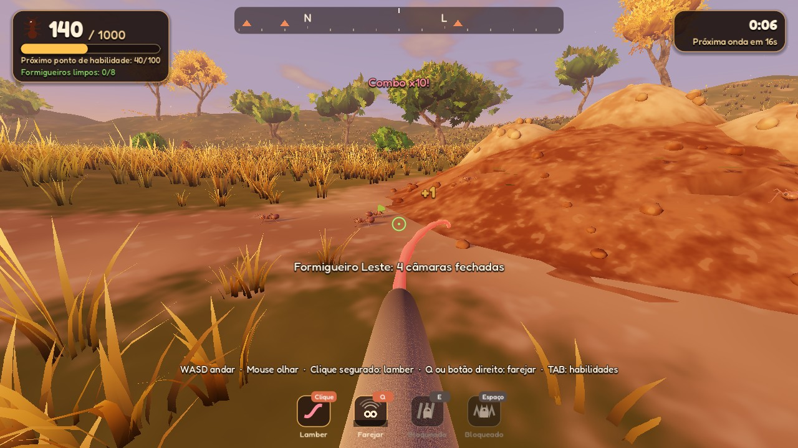
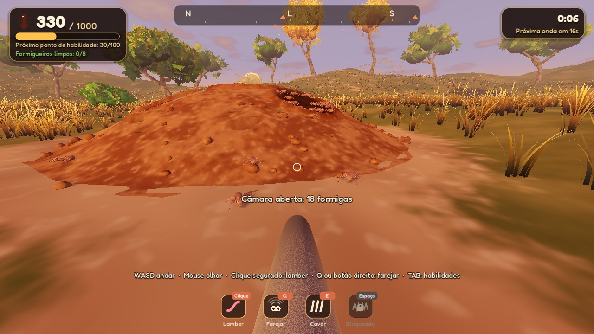

# Anteater Simulator

Um jogo **relaxante de "arrumar e limpar"**, inspirado em *Leaf it Alone* e
*Librarian: Tidy Up the Arcane Library*: você é um **tamanduá-bandeira** que
come formigas e cupins no **cerrado**, evolui habilidades e deixa a região
**100% limpa**. Não dá para perder, e o jogo tem fim. Para **PC (Steam)**, em
**3D estilizado** com cara de filme de animação, visto pelos olhos do tamanduá.
Feito em **Godot 4.7**.

**Tudo o que foi decidido sobre o jogo está em
[`docs/DESIGN.md`](docs/DESIGN.md)**: o documento de design, o plano de
produção, os protótipos e as decisões, num lugar só.


| | |
|---|---|
|  |  |
|  |  |

> Capturas feitas em um servidor sem placa de vídeo (renderização por software).
> No seu PC fica igual ou melhor.

---

## A demo jogável

Uma **clareira do cerrado no fim da tarde**, cercada por penhascos. O tamanduá
acorda numa **caverna**, vê lá longe um **cupinzeiro gigante** e a barriga
ronca: hora de comer. A colônia tem **3200 formigas** e **12 formigueiros**.
Parte das formigas anda pelas trilhas de terra e chega em **ondas**; o resto
mora nas **câmaras** dos formigueiros (e em algumas câmaras no meio do campo),
que você abre cavando. Os 5 formigueiros grandes guardam uma **rainha**. **Cada
formiga comida vale 1 ponto** e cada habilidade tem o seu preço. Com a clareira
**100% limpa**, as garras quebram o **tronco caído** que fecha a saída, e a demo
termina.

A demo é a **primeira área** de um mapa maior, todo cercado por penhascos, que
leva até o cupinzeiro gigante; o plano está em
[`docs/DESIGN.md`](docs/DESIGN.md).

### Como rodar

1. Instale o **Godot 4.7** (versão padrão, não precisa da .NET):
   <https://godotengine.org/download>
2. No Gerenciador de Projetos, clique em **Importar** e escolha o arquivo
   `project.godot` desta pasta.
3. Aperte **F5** (ou o botão ▶). Na primeira vez o Godot importa sons e
   texturas, o que leva alguns segundos.

O jogo abre em **tela cheia**; **F11** (ou Alt+Enter) alterna com a janela. O
projeto usa o renderizador **Forward+** (PC com placa de vídeo compatível com
Vulkan, Direct3D 12 ou Metal). Em **Configurações** dá para trocar o modo de
tela, a resolução e a qualidade gráfica.

### Controles

| Ação | Teclado e mouse | Controle |
|---|---|---|
| Andar | `W` `A` `S` `D` | analógico esquerdo |
| Olhar | mouse | analógico direito |
| Correr* | `Shift` | clicar o analógico esquerdo |
| **Lamber** | clique esquerdo (segure, com Lambida Contínua*) | `RT` |
| Farejar* | `Q` ou clique direito | `LT` |
| Cavar* (abrir câmara, quebrar o tronco) | segure `E` perto | `X` |
| Tremor* (pulo) | `Espaço` | `A` |
| Árvore de habilidades | `Tab` | `Back` |
| Pausa | `Esc` | `Start` |
| Tela cheia | `F11` ou `Alt+Enter` | |

\* liberados pela árvore de habilidades.

### O que tem na demo hoje

- **Câmaras:** os montinhos de terra clara nos formigueiros são câmaras
  fechadas, e 12 delas ficam sozinhas no meio do campo. Com **Cavar** (Garras),
  segure `E` perto de uma para abri-la: as moradoras **saem correndo**, fogem
  quando você chega perto e depois voltam para casa. Até 40 ficam à vista; as
  outras saem do túnel conforme você come. Depois de cavar, as garras descansam
  (25 s no começo).
- **Suba nos formigueiros:** lá de cima dá para ver dentro das câmaras abertas.
- **Rainha:** fica na câmara do topo dos formigueiros grandes, protegida pelas
  outras formigas. Coma todas em volta e ela vale **20**.
- **Língua:** no começo ela vai reta até onde você mira e pega a formiga perto
  da ponta. Com **Língua Certeira**, ela vai sozinha atrás da formiga mais perto
  da mira (marcada com um anel verde); a **Mira Ampla** aumenta essa área.
- **Trilhas e ondas:** quem volta para o formigueiro sai de novo mais tarde; só
  as que você come somem de vez.
- **Formigas fogem** quando você chega correndo: chegue andando e lamba de longe.
  Correndo também não dá para lamber, até aprender **Lamber Correndo**.
- **Faro:** primeiro só diz quantas formigas há por perto e a que distância
  está a mais perto. Com Precisão, mostra uma nuvem borrada onde elas estão e
  depois as formigas brilhando através do capim; o Faro de Câmara mostra as
  câmaras fechadas. Nos níveis altos, a bússola mostra quanto falta em cada
  formigueiro e onde estão as rainhas. A cor do faro (vermelha) pode ser trocada
  em Configurações → Jogo.
- **Tremor:** um pulo; ao cair, as formigas em volta ficam tontas.
- **Tanajuras** (douradas, voando) ativam o **Frenesi**: língua mais rápida e
  mais longa por 6 s.
- **Progresso:** formigueiro limpo ganha flores, e o contador mostra quantos
  faltam.
- **Penhascos e caverna:** a clareira é cercada por penhascos de arenito (o fim
  do mapa). Você começa numa caverna no pé deles, e uma trilha de terra leva até
  o formigueiro mais perto. O cupinzeiro gigante aparece lá longe, por cima dos
  penhascos. É sempre o mesmo fim de tarde, e há duas lagoas de enfeite.
- **Árvore de habilidades** (`Tab`): uma constelação, com os ramos saindo do
  centro. Passe o mouse numa habilidade para ver o que ela faz e clique para
  aprender; as aprendidas acendem em dourado. Ela não abre sozinha: um aviso
  lembra quando já dá para aprender algo.
- **Fim da demo:** um tronco caído fecha a passagem para a próxima área. Com
  todas as formigas comidas, a bússola mostra a saída: segure `E` perto do
  tronco e as garras quebram o tronco.
- **Sem derrota.** O jogo **salva sozinho**; na tela inicial aparecem
  **Continuar** e **Novo jogo**.

### Habilidades

| Habilidade | Níveis (preço em pontos) |
|---|---|
| **Língua** | Lambida Contínua (25: segurar para lamber), e depois três linhas: **Bocado** · Lambida (40: até 5 por lambida) · Lambida Larga (75: até 15) · Lambida Gulosa (115: até 25) · Lambida Voraz (170: até 40); **Destreza** · Língua Comprida (70) · Saliva Grudenta (100) · Língua Turbo (150); **Mira** · Língua Certeira (30: a língua vai atrás da formiga mais perto da mira) · Mira Ampla (60: essa área 25% maior) |
| **Garras** | Cavar (35: depois as garras descansam 25 s), e depois: **Força** · Garras Fortes (70) · Tremor (110: recarga de 21 s) · Terremoto (170); **Rapidez** · Garras Ágeis (50: descanso de 15 s) · Garras Incansáveis (95: 5 s) · Recarga do Tremor (130: 14 s) · Recarga Relâmpago (150: 7 s) |
| **Patas** | Corrida (30: +25%), e depois: **Velocidade** · Patas Ligeiras (80: mais 25%) · Galope Silencioso (130); **Agilidade** · Lamber Correndo (60) |
| **Faro** | Farejar (20), e depois: **Alcance** · Faro Atento (40: 16 m) · Faro Apurado (70: 24 m) · Faro Aguçado (110: 34 m) · Faro Lendário (160: 50 m); **Precisão** · Faro Preciso (45: nuvem) · Faro Nítido (85: formigas brilhando) · Faro de Câmara (100) |
| **Escalada + Cauda** | Escalada (300) · Cauda Preênsil (400): ainda não feitas (aparecem com cadeado) |

1 formiga comida = 1 ponto (a rainha vale 20). As linhas de um ramo não se
excluem. Tudo o que dá para aprender no Cerrado soma 2575 pontos, e dá para
redistribuir os pontos de graça na árvore.

### Tela e gráficos

Em **Configurações**:

- **Tela:** janela, tela cheia ou tela cheia exclusiva; resolução (em tela
  cheia, ela muda só o 3D e a interface continua nítida); resolução do 3D (50 a
  100%); VSync; limite de FPS.
- **Gráficos:** um preset ajusta tudo de uma vez, ou ajuste item por item:
  sombras, capim, suavização (FXAA, MSAA ou TAA), sombra de contato (SSAO), luz
  rebatida (SSIL), neblina volumétrica e brilho do sol.
- **Jogo:** sensibilidade do mouse, inverter eixo Y, campo de visão e balanço
  da câmera.

| Preset | O que muda |
|---|---|
| Baixa | menos capim, sombras curtas, sem SSAO, FXAA, resolução 3D a 80% |
| Média | SSAO, sombras médias, MSAA 2x (padrão com vídeo integrado) |
| Alta | capim denso, sombras longas (padrão com placa de vídeo dedicada) |
| Ultra | ainda mais capim, neblina volumétrica, SSIL, MSAA 4x |

---

## Modelos 3D gerados por IA

Tudo na demo funciona com modelos **feitos por código** (formas suaves,
pelagem, folhas recortadas). Para trocar por modelos gerados por IA no mesmo
estilo:

- **[`docs/prompts-ia.md`](docs/prompts-ia.md)**: guia de estilo, paleta e o
  prompt de cada modelo.
- **[`assets/models/LEIA-ME.md`](assets/models/LEIA-ME.md)**: nomes de arquivo
  e ajustes. Basta colocar o `.glb` em `assets/models/` que o jogo troca sozinho.

O **formigueiro** já foi gerado na Artlist (Hyper3D Rodin, com a geração 3D
gratuita da conta) e está no seu histórico de lá. O download do `.glb` exige um
plano com créditos de IA; depois de baixar, salve como
`assets/models/formigueiro.glb`.

---

## Para quem mexe no código

```
project.godot            configuração (Forward+, autoloads, uniforms globais)
scenes/main.tscn         cena principal
scripts/
  main.gd                estados do jogo (menu, jogando, pausa, árvore, fim)
  model_library.gd       troca automática pelos modelos de IA (.glb)
  autoload/              Settings, GameState (habilidades/progresso), Sfx, DevTools
  world/                 terreno, trilhas, formigueiros, vegetação, capim, céu e sol
  ants/                  malhas das formigas, simulação do enxame, colônia e ondas
  player/                tamanduá em 1ª pessoa, focinho, patas e língua
  procedural/            construtor de malhas suaves (elipsoides, tubos, icosferas)
  ui/                    HUD, árvore de habilidades, menus e tema
shaders/                 capim, terreno, céu, folhagem, pelagem, língua, formigas...
assets/                  fontes, texturas e sons gerados, modelos de IA
tools/                   scripts Python que geram os sons e as texturas
docs/                    documento do jogo, plano de produção, prompts de IA e capturas
prototipos/m1-loop/      protótipo 2D do loop (M1): outro projeto Godot, abra à parte
```

Sons e texturas são gerados por código (só precisam de Python 3 + numpy):

```bash
python3 tools/gen_audio.py
```

```bash
python3 tools/gen_textures.py
```

Opções de teste (depois de `--` na linha de comando do Godot):

```bash
godot --path . -- --start=play --autoplay --timescale=4 --stats
```

`--start=play|tree|settings|howto` pula o menu · `--autoplay` um bot joga sozinho ·
`--give=N` começa com N formigas · `--buy=lingua_segurar,garras_cavar` aprende
habilidades · `--open=N|all` abre as câmaras · `--sniff=SEG` fareja nesse
instante · `--growl` faz a barriga roncar mesmo pulando o menu ·
`--focus=ID` abre a árvore já com uma habilidade escolhida · `--nohud` esconde a
interface (capturas limpas do cenário) ·
`--captures=SEG:arquivo.png` tira
capturas (numa janela de 1600x900) · `--quit` fecha depois · `--stats` mostra
FPS, formigas vivas e o tempo gasto por quadro.

## Créditos

- Fonte **Fredoka**: The Fredoka Project Authors, licença SIL Open Font License
  1.1 (`assets/fonts/OFL.txt`).
- Todo o resto (modelos provisórios, texturas, sons e a música de violão) é
  gerado por código neste repositório.
