# Anteater Simulator

Um jogo **relaxante de "arrumar e limpar"**, inspirado em *Leaf it Alone* e
*Librarian: Tidy Up the Arcane Library*: você é um **tamanduá-bandeira** que
come formigas e cupins no **cerrado**, evolui habilidades e deixa a região
**100% limpa**. Não dá para perder, e o jogo tem fim. Para **PC (Steam)**, em
**3D estilizado** com cara de filme de animação, visto pelos olhos do tamanduá.
Feito em **Godot 4.7**.

**Tudo o que foi decidido sobre o jogo está em
[`docs/DESIGN.md`](docs/DESIGN.md)**: o documento de design, o plano de
produção, os protótipos e as decisões, num lugar só.

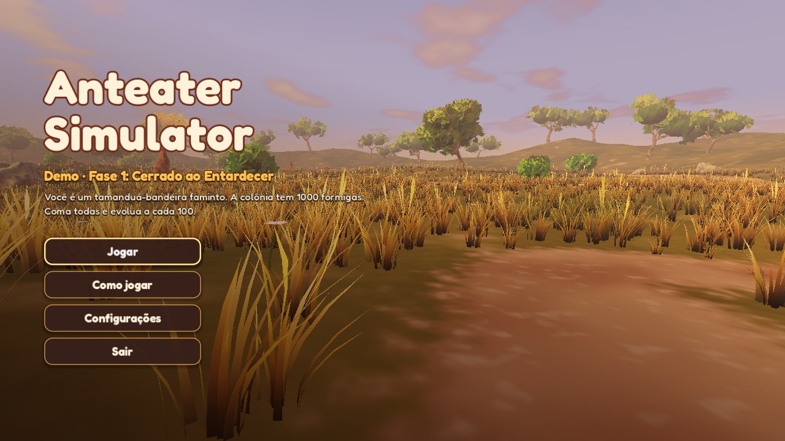

| | |
|---|---|
| 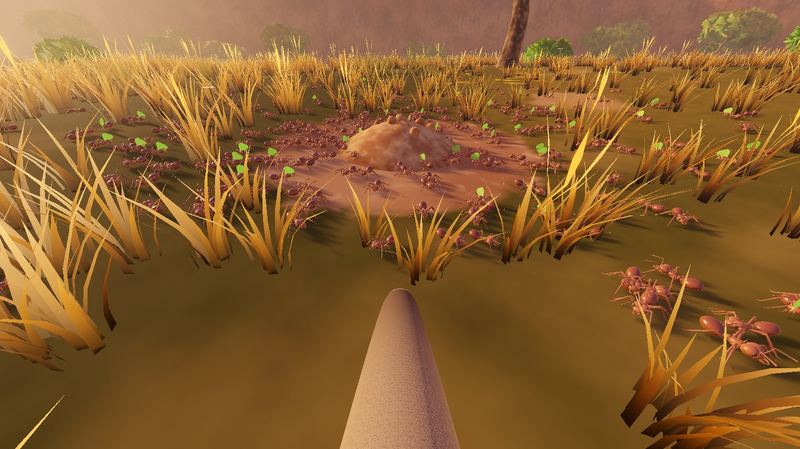 | 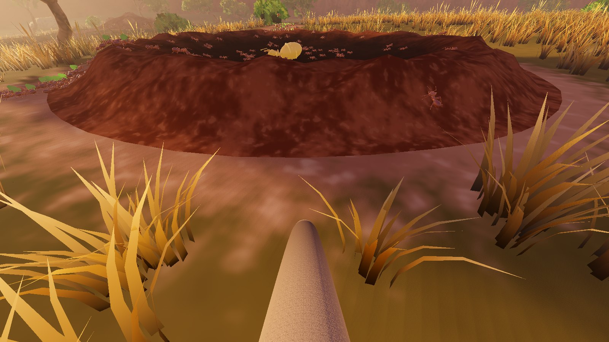 |
| 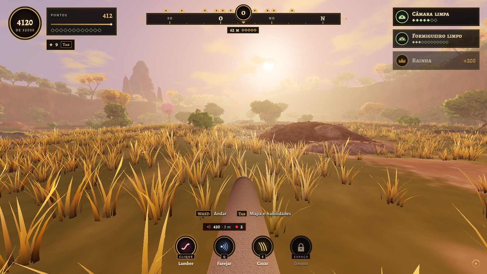 | 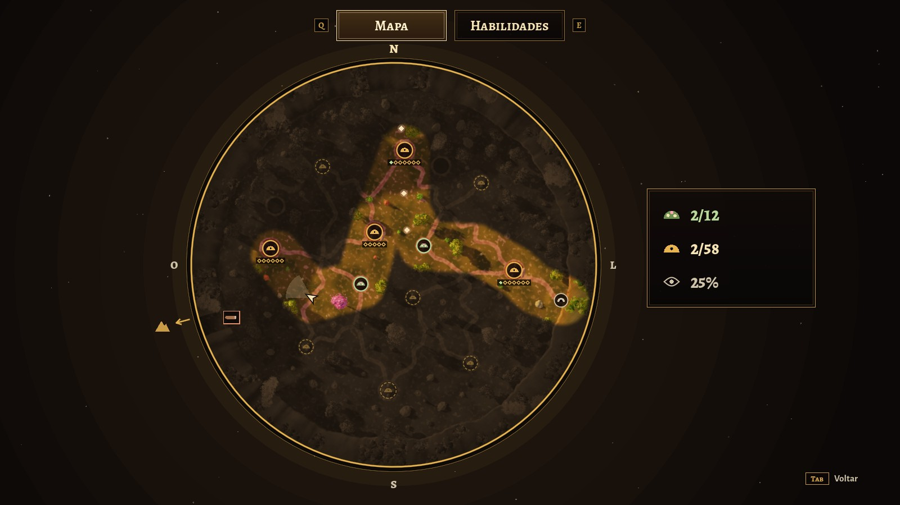 |
| 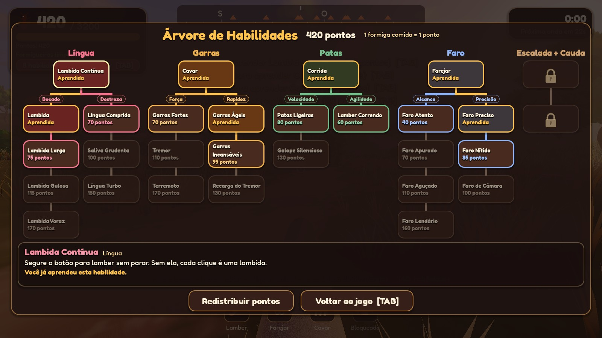 | 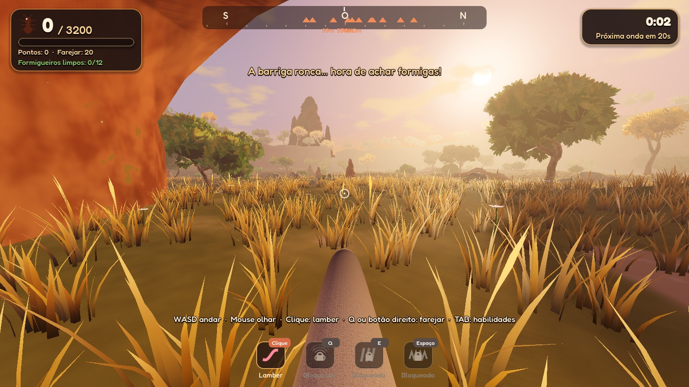 |
| 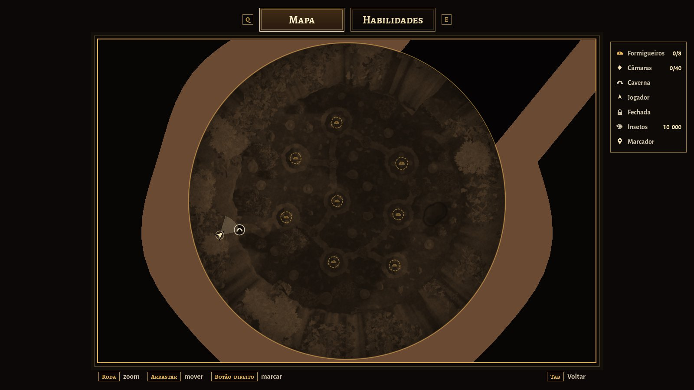 | 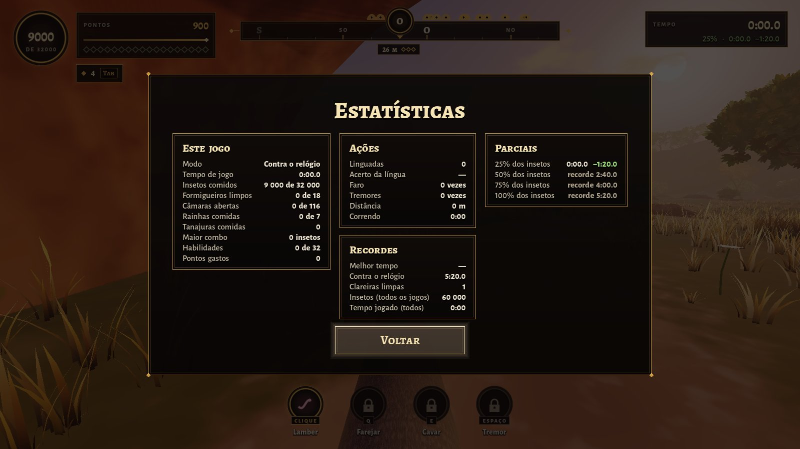 |
| 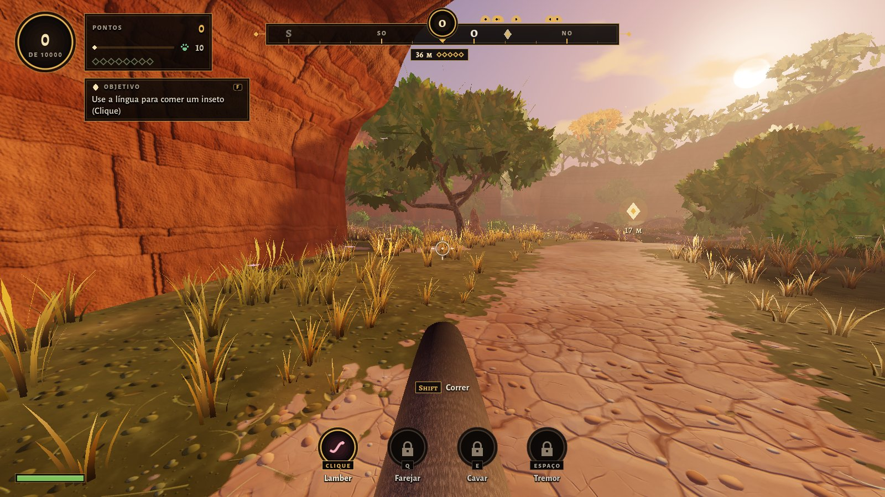 | 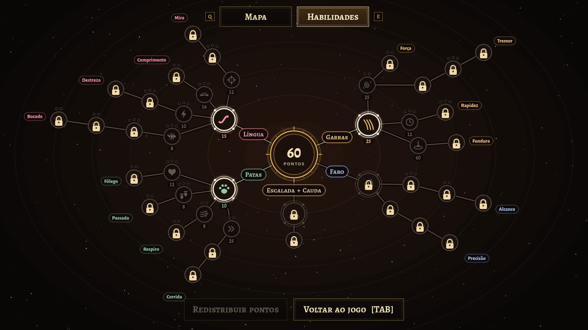 |
| 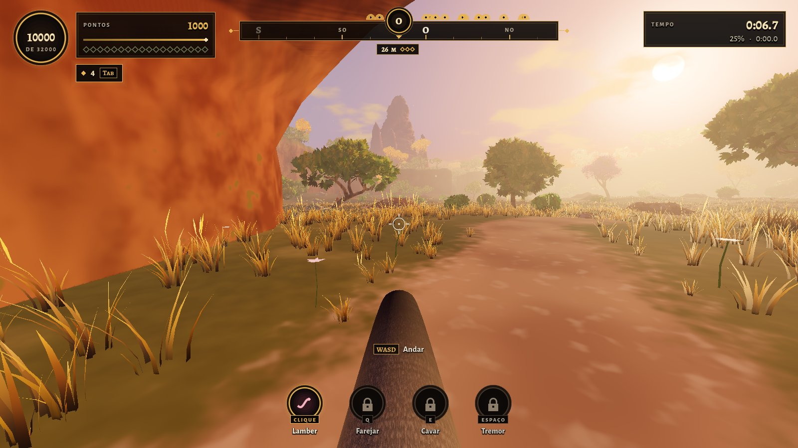 | 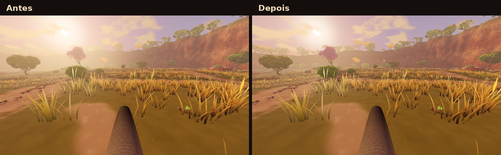 |

> Capturas feitas em um servidor sem placa de vídeo (renderização por software).
> No seu PC fica igual ou melhor.

---

## A demo jogável

Uma **clareira do cerrado no fim da tarde**, cercada por penhascos. O tamanduá
acorda numa **caverna**, vê lá longe um **cupinzeiro gigante** e a barriga
ronca: hora de comer. A clareira tem uns 50 m de ponta a ponta, **10 000
insetos**, cada um andando sozinho, e **8 formigueiros**. Um quarto anda em
fila pelas trilhas de terra, um quarto passeia pelo campo em volta das câmaras
espalhadas pelo mapa (sobem nas pedras, nos troncos caídos e um pouco nos
troncos das árvores), e a metade mora nas **câmaras**, que você abre cavando.
Perto da caverna ficam os 5 formigueiros pequenos; os 2 médios e o grande,
do lado da saída, que guarda a **rainha** bem no fundo. Um **objetivo** no
canto da tela diz o que fazer, um de cada vez, e um losango voa até o lugar
certo (`F` mostra de novo). **Cada 10 insetos comidos valem 1
ponto** e cada habilidade tem o seu preço. Com a clareira **100% limpa**, as garras quebram o
**tronco caído** que fecha a saída, e a demo termina.

A demo é a **primeira área** de um mapa maior, todo cercado por penhascos, que
leva até o cupinzeiro gigante; o plano está em
[`docs/DESIGN.md`](docs/DESIGN.md). A pesquisa sobre o ciclo das habilidades e a
economia da compra, com a simulação do bot e a proposta de reformulação, está
em [`docs/pesquisa-habilidades.md`](docs/pesquisa-habilidades.md).

### Como rodar

1. Instale o **Godot 4.7** (versão padrão, não precisa da .NET):
   <https://godotengine.org/download>
2. No Gerenciador de Projetos, clique em **Importar** e escolha o arquivo
   `project.godot` desta pasta.
3. Aperte **F5** (ou o botão ▶). Na primeira vez o Godot importa sons e
   texturas, o que leva alguns segundos.

O jogo abre em **tela cheia**; **F11** (ou Alt+Enter) alterna com a janela. O
projeto usa o renderizador **Forward+** (PC com placa de vídeo compatível com
Vulkan, Direct3D 12 ou Metal). Em **Configurações** dá para trocar o modo de
tela, a resolução e a qualidade gráfica.

### Controles

| Ação | Teclado e mouse | Controle |
|---|---|---|
| Andar | `W` `A` `S` `D` | analógico esquerdo |
| Olhar | mouse | analógico direito |
| Correr (gasta estamina) | `Shift` | clicar o analógico esquerdo |
| **Lamber** | clique esquerdo (segure, com Lambida Rápida*) | `RT` |
| Farejar* | `Q` ou clique direito | `LT` |
| Cavar* (abrir câmara, quebrar o tronco) | segure `E` perto, olhando para ela | `X` |
| Pular (subir nas pedras, sair dos buracos) | `Espaço` | `A` |
| Tremor* (pulo que atordoa) | `X` | `B` |
| Mapa, habilidades e estatísticas | `Tab` (o mapa abre primeiro; `Q` e `E` trocam a aba) | `Back` (`LB` e `RB` trocam a aba) |
| Mostrar o objetivo de novo | `F` | `Y` |
| Marcar um ponto no mapa | clique direito no mapa | `Y` no mapa |
| Pausa | `Esc` | `Start` |
| Tela cheia | `F11` ou `Alt+Enter` | |

\* liberados pela árvore de habilidades. Todas as teclas podem ser trocadas em
Configurações → Controles, e Correr e Cavar podem ser "segurar" ou "apertar
uma vez".

### O que tem na demo hoje

- **Interface no estilo "Constelação"** (o mesmo da árvore de habilidades):
  painéis com moldura dourada, as formigas comidas num medalhão e as habilidades
  em círculos, embaixo: só as que você já aprendeu, na ordem Lamber, Olheiro,
  Cavar, Farejar e Tremor. A bússola é uma faixa com o rumo no meio; o formigueiro à sua
  frente mostra a distância, as câmaras dele (as verdes já estão limpas) e
  quantas formigas dele faltam: na trilha, passeando no campo e dentro das
  câmaras, com uma coroa se a rainha está viva.
- **Pouco texto na tela:** conquistas viram **cartões** no canto direito (câmara
  limpa, formigueiro limpo, rainha, Frenesi, habilidade aprendida); as **dicas**
  são curtas, embaixo da mira, com a tecla num quadradinho ("E Abrir câmara");
  salvar é só um ícone girando. Em Configurações → Jogo, **Dicas** pode ser
  Todas, Poucas ou Nenhuma.
- **Mapa** (`Tab`): o mapa inteiro visto de cima, com a saída para cima e para
  a direita. A clareira fica colorida onde você já andou; as áreas 2, 3 e 4
  aparecem pretas, com cadeado. A roda do mouse aproxima e arrastar move. Mostra
  os formigueiros (limpos, começados ou não visitados), **quantos insetos
  faltam em cada formigueiro já visto**, as câmaras que você já viu, a caverna
  e você; passe o mouse num formigueiro para ver a área dele. Clique direito
  põe um **marcador**, que aparece na bússola com a distância.
- **Estatísticas** (botão na pausa, `Esc`, e na tela do fim): os números do jogo
  (insetos, formigueiros, câmaras, rainhas, maior combo, linguadas e acerto,
  distância andada...).
- **Objetivos:** um cartão no canto mostra o objetivo da vez, com o
  progresso ("120 / 200"): andar, comer um inseto, comer 200, aprender uma
  habilidade, abrir uma câmara, limpar um formigueiro, comer metade, comer tudo
  menos o formigueiro da rainha, desmanchar o monte dela, comer todos e quebrar
  o tronco. Quando o objetivo tem um lugar, um
  losango sai do cartão, voa numa leve curva até o alvo e fica pulsando com a
  distância; depois some, e `F` faz ele voar de novo. O que você já fez é
  pulado. O losango segue a opção de Dicas.
- **Marcos:** limpar o primeiro formigueiro, comer metade dos insetos e comer
  80% abrem habilidades novas na árvore, com um cartão grande na tela. No
  terceiro marco, o **Farejar** vem de presente. O quarto chega quando só falta
  o formigueiro da rainha: a **Cavar fundo nível 2** vem de presente.
- **10 000 insetos, um a um:** nas trilhas elas vão e voltam do arbusto
  (muitas carregando folhas); no campo, saem das câmaras, dão uma volta e
  entram de novo. Cada uma foge sozinha quando você chega perto, e cada
  formiga comida conta 1. Uma em cada 16 000 usa um chapéu de Natal.
- **Câmaras:** os montinhos de terra clara nos formigueiros são câmaras
  fechadas, e 12 delas ficam sozinhas no meio do campo, espalhadas por igual (as formigas que
  passeiam em volta contam para o formigueiro dono da câmara). Com **Cavar**
  (Garras), segure `E` perto de uma, olhando para ela, para abri-la: as moradoras **saem
  correndo** e, alguns segundos depois, voltam a passear até 5 m da câmara
  (por cima do monte também); fogem quando você chega perto. Até 40
  ficam à vista; as outras saem do túnel conforme você come. Depois de cavar,
  as garras descansam (25 s no começo). As câmaras grandes, de tampa mais
  escura, pedem **Cavar fundo nível 1**.
- **Suba nos formigueiros:** lá de cima dá para ver dentro das câmaras abertas.
- **Rainha:** mora no fundo dos formigueiros grandes. Com **Cavar fundo nível 2** (Garras),
  cave o topo do monte: ele se desmancha inteiro e fica um buraco com a rainha
  andando devagar lá embaixo, junto com as moradoras das outras câmaras dele.
  Coma a corte e ela vale **200 formigas** (20 pontos).
- **Língua:** no começo ela é lenta (pouco mais de uma lambida por segundo) e
  vai reta até onde você mira, pegando **uma** formiga perto da ponta (a linha
  de Bocado aumenta até 40). Uma tanajura voando no caminho para a
  língua, e a ponta vai atrás dela se ela fugir. A linha
  de Destreza a deixa mais rápida, e a de Comprimento, mais longa. Com **Mira nível 1**, ela vai sozinha atrás da formiga mais perto
  da mira (com um contorno verde suave) e acompanha o inseto; a **Mira nível 2**
  aumenta essa área (6° → 11° → 16° → 22°). Sem Mira, a língua vai reta.
  Com **Olheiro**, mire num buraco do monte (ou no túnel de uma câmara aberta)
  e lamba: a língua entra, gira lá dentro e volta com formigas escondidas
  (5 no começo, até 20), com uma recarga de 5 s a 2 s. É uma ajuda: cada câmara
  fechada guarda metade das moradoras, que só saem cavando.
- **Trilhas:** as formigas vão e voltam sem parar; só as que você come somem
  de vez.
- **Formigas fogem** quando você chega perto: a 2 m de você parado, a 2,5 m
  andando e mais longe ainda correndo. Nem todas fogem: 35% delas andando, 70%
  correndo, e nenhuma com **Corrida nível 3**. As da trilha e as que passeiam andam na
  mesma velocidade (0,7 m/s); as moradoras das câmaras, mais devagar. Quando você come uma, cada uma das que
  estão a até 1,5 m dela tem 20% de chance de sair correndo (com Corrida nível 3, nenhuma), mais devagar
  (as tontas continuam tontas). Chegue devagar e lamba de longe (a
  língua alcança 1 m, e mais com Comprimento).
  Correndo também não dá para lamber, até aprender **Corrida nível 2**.
- **Faro:** fareja a família do formigueiro mais perto (perto de uma câmara
  aberta, só as moradoras dela): diz quantas são e a que distância está a mais
  perto, e a bússola aponta o maior grupo. A linha de **Rastro** mostra colunas
  de cheiro nas câmaras fechadas desse formigueiro, e depois também nas dos
  outros por perto (e a bússola passa a mostrar quanto falta em cada um). A
  linha de **Família** mostra a família: primeiro um brilho borrado através do
  capim, depois por mais tempo e até as que estão longe na trilha, e no fim cada
  formiga dela, nítida. A cor do faro (vermelha) pode ser trocada em
  Configurações → Jogo.
- **Tremor:** um pulo; ao cair, as formigas em volta ficam tontas.
- **Tanajuras** (douradas, voando, batendo as asas de vez em quando quando estão perto)
  ativam o **Frenesi**: língua mais rápida e mais longa por 6 s. Cada tanajura
  ou cogumelo comido com o Frenesi ligado soma 3 s.
- **Cogumelos** (grupinhos laranja ao pé de árvores, troncos e arbustos) também
  dão o Frenesi. Comido, o grupinho nasce de novo no mesmo lugar, pequenino, e
  leva 90 s para crescer e poder ser comido de novo; um anel pequeno em cima
  dele vai enchendo enquanto cresce (o jogo salvo lembra).
- **Progresso:** formigueiro limpo ganha flores, e um losango por formigueiro
  no canto da tela mostra quantos faltam.
- **Penhascos e caverna:** a clareira é cercada por penhascos de arenito (o fim
  do mapa). Você começa numa caverna no pé deles, e uma trilha de terra leva até
  o formigueiro mais perto. O cupinzeiro gigante aparece lá longe, por cima dos
  penhascos. É sempre o mesmo fim de tarde, e há uma lagoa de forma irregular,
  com um tronco caído entrando na água: uma fila de formigas anda por cima
  dele até perto de onde a água toca. O alto
  dos penhascos é cheio de árvores, e depois da passagem para a próxima área
  uma rampa sobe para uma mata fechada.
- **Árvore de habilidades** (`Tab`, aba ao lado do mapa): uma constelação, com
  os ramos saindo do centro. Passe o mouse numa habilidade para ver o que ela
  faz (com os números de antes → depois do próximo clique) e clique para
  aprender; as bolinhas em volta mostram os cliques, e as completas acendem em
  dourado. Ela não abre
  sozinha: um selo no canto (◆ 2 Tab) mostra quando já dá para aprender algo.
- **Fim da demo:** um tronco caído fecha a passagem para a próxima área. Com
  todas as formigas comidas, a bússola mostra a saída: segure `E` perto do
  tronco e as garras quebram o tronco.
- **Sem derrota.** O jogo **salva sozinho**, em até **3 jogos salvos**; na tela
  inicial, **Continuar** abre o mais recente e **Jogos salvos** mostra os três
  (dá para apagar um).

### Habilidades

Cada habilidade tem de **1 a 3 cliques** (bolinhas em volta dela na árvore):
cada clique é uma melhora pequena, com o seu preço, e a habilidade seguinte da
linha só abre com todos os cliques da anterior. Entre parênteses: o preço de
cada clique em pontos e, depois do ponto, **quando ela abre**. Sem nada, desde
o começo. Os **marcos** da área 1 são: **Formigueiro** (o primeiro formigueiro
limpo), **Metade** (metade dos insetos), **80%** (80% dos insetos; o Farejar
vem de presente) e **Rainha** (só falta o formigueiro da rainha; a Fundura
nível 2 vem de presente). **Área 2** fica para depois da demo. Na árvore, o que ainda
não abriu aparece só com o cadeado.

| Habilidade | Níveis (preço de cada clique · quando abre) |
|---|---|
| **Língua** | Lambida Rápida (15: segurar para lamber), e depois quatro linhas: **Bocado** · nível 1 (8, 12, 16: 2 → 3 → 5 insetos por lambida) · nível 2 (30, 40, 50 · Formigueiro: 8 → 11 → 15) · nível 3 (70, 90 · Área 2: 20 → 25) · nível 4 (160, 200 · Área 2: 32 → 40); **Destreza** · nível 1 (10, 14, 18: 1,6 → 1,8 → 2 lambidas por segundo; eram 1,4) · nível 2 (50, 60, 70 · Metade: 2,4 → 2,8 → 3,2) · nível 3 (260 · Área 2: 4,4); **Comprimento** · nível 1 (16, 20, 24: língua de 1,5 → 2 → 2,5 m; era 1) · nível 2 (60, 80 · Área 2: 3 → 3,5 m); **Mira** · nível 1 (12: a língua vai atrás do inseto mais perto da mira, numa área de 6°, e o acompanha) · nível 2 (25, 30, 35 · Formigueiro: 11° → 16° → 22°) · nível 3 (110 · Área 2: área da mira de 30°); **Olheiro** · nível 1 (20 · Formigueiro: a língua entra num buraco e puxa 5 formigas; recarga de 5 s) · nível 2 (30, 40, 50 · Metade: 8 → 11 → 15 formigas; 4 → 3,5 → 3 s) · nível 3 (120 · Área 2: 20 formigas; 2 s) |
| **Garras** | Cavar (25: câmaras pequenas; depois as garras descansam 25 s), e depois: **Força** · nível 1 (25, 35: moradoras tontas por 1,5 → 2,5 s) · nível 2 (40, 50 · Metade: 3,2 → 4 s); **Tremor** (sai de Força nível 1) · nível 1 (90 · Metade: libera o Tremor, recarga de 21 s) · nível 2 (45, 55, 65 · Área 2: 18 → 15 → 12 s) · nível 3 (300 · Área 2: Terremoto, 7 s); **Rapidez** · nível 1 (12, 16, 20: descanso de 20 → 16 → 12 s) · nível 2 (40, 50, 60 · Área 2: 9 → 7 → 5 s; no último clique, cava na metade do tempo); **Cavar fundo** · nível 1 (60: câmaras grandes) · nível 2 (de presente no marco Rainha: desmancha o monte da rainha) |
| **Patas** | Fôlego (10: estamina máxima de 50 para 75), e depois quatro linhas: **Corrida** · nível 1 (25, 35: corre 10% e mais 10% mais rápido) · nível 2 (90 · Área 2: lamber correndo) · nível 3 (250 · Área 2: os insetos não fogem mais); **Respiro** · nível 1 (8, 12: a estamina volta 4 → 5 por segundo; eram 3) · nível 2 (30, 40 · Formigueiro: 6 → 7); **Passada** · nível 1 (8, 12, 16: correndo gasta 9 → 8 → 7 por segundo; eram 10) · nível 2 (40, 50 · Formigueiro: 6 → 5); **Fôlego** · nível 1 (12, 16, 20: 100 → 125 → 150) · nível 2 (50, 60 · Área 2: 175 → 200) |
| **Faro** | Farejar (de presente no marco 80%: as moradoras da câmara aberta mais perto, a até 12 m, brilham por 4 s; a bússola aponta o maior grupo; recarga de 10 s), e depois: **Rastro** · nível 1 (20 · 80%: colunas nas câmaras fechadas do formigueiro farejado) · nível 2 (40, 55 · Área 2: também as câmaras dos outros a até 25 → 40 m; no último clique, a bússola mostra quanto falta em cada formigueiro); **Família** · nível 1 (30 · 80%: a família do ninho mais perto, não só a câmara, com um brilho borrado através do capim, a até 16 m) · nível 2 (50, 65 · Área 2: dura 6 → 8 s e pega a família inteira, até longe na trilha) · nível 3 (180 · Área 2: cada formiga da família, nítida) |
| **Escalada** | Escalada (300): Área 2, ainda não feitas (aparecem com cadeado) |

**Estamina:** correr existe desde o começo, mas gasta a estamina, a barra verde
no canto de baixo, à esquerda (fica vermelho-escura quando acaba). Ela só volta
1 s depois de parar de correr; se zerar, dá para correr de novo quando encher
15%. Começa com 50, gasta 10 por segundo e volta 3 por segundo.

10 formigas comidas = 1 ponto (a rainha vale 20 pontos). As linhas de um ramo
não se excluem. Na área 1 há uns 1 000 pontos para ganhar, e o que abre nela
custa 1 442: não dá para comprar tudo, é preciso escolher. Dá para
redistribuir os pontos de graça na árvore (o Farejar de presente não sai). As
contas estão em [`docs/pesquisa-habilidades.md`](docs/pesquisa-habilidades.md),
seção 11. Os jogos salvos de antes da área 1 nova não abrem mais.

### Versão para Windows e Mac (para mandar aos amigos)

O GitHub gera o jogo para Windows e para Mac sozinho: na aba **Actions**,
escolha **Versão para Windows e Mac** › **Run workflow**, escreva o número da
versão (por exemplo `0.1.2`) e clique no botão verde. Em uns 5 minutos, o
`AnteaterSimulator-0.1.2-windows.zip` e o `AnteaterSimulator-0.1.2-mac.zip`
aparecem em **Releases** (na lateral direita da página do repositório), com as
instruções para quem vai jogar. É só mandar o link dessa página. Por enquanto
fica só a versão mais nova: ao publicar uma, a automação apaga as anteriores.
O número escolhido aparece no menu ("Versão de teste 0.1.2") e nas
estatísticas, para saber qual versão cada amigo jogou.

A versão do Mac roda nos Macs com chip Apple e nos com Intel. Como não tem a
assinatura da Apple (que é paga), na primeira vez o Mac pede para liberar o
jogo em **Ajustes do Sistema › Privacidade e Segurança › Abrir Mesmo Assim**.
Para ela funcionar nos chips da Apple, o projeto prepara as texturas também no
formato desses chips (opção **Import ETC2 ASTC** do `project.godot`); a versão
do Windows leva só o formato dela.

A configuração de exportação fica em `export_presets.cfg` e a automação em
`.github/workflows/versao.yml`. Para gerar à mão no Godot: **Projeto ›
Exportar › Windows** ou **macOS** (precisa dos modelos de exportação 4.7.2
instalados).

### Tela e gráficos

Em **Configurações**:

- **Tela:** janela, tela cheia ou tela cheia exclusiva; resolução (em tela
  cheia, ela muda só o 3D e a interface continua nítida); resolução do 3D (50 a
  100%); VSync; limite de FPS; medidor de desempenho (FPS, tempo do quadro e
  da placa de vídeo, triângulos), que também liga e desliga com **F3**.
- **Gráficos:** um preset ajusta tudo de uma vez, ou ajuste item por item:
  sombras, capim, suavização (FXAA, SMAA, MSAA, MSAA 2x + SMAA ou TAA), sombra de contato (SSAO), luz
  rebatida (SSIL), neblina volumétrica e brilho do sol.
- **Jogo:** sensibilidade do mouse e do controle, inverter eixo Y, campo de
  visão, balanço da câmera, cor do faro, dicas (Todas, Poucas ou Nenhuma),
  mostrar ou esconder a interface (HUD).
- **Controles:** trocar qualquer tecla; Correr e Cavar como "segurar" ou
  "apertar uma vez".
- **Áudio:** volume geral, música, efeitos e ambiente.

| Preset | O que muda |
|---|---|
| Baixa | menos capim, sombras curtas, sem SSAO, FXAA, resolução 3D a 80% |
| Média | SSAO, sombras médias, MSAA 2x (padrão com vídeo integrado) |
| Alta | capim denso, sombras longas (padrão com placa de vídeo dedicada) |
| Ultra | ainda mais capim, neblina volumétrica, SSIL, MSAA 2x + SMAA |

Quem escolhe um preset recebe os valores dele mesmo quando o preset muda numa
versão nova; só a qualidade **Personalizada** guarda item por item.

---

## Modelos 3D gerados por IA

Tudo na demo funciona com modelos **feitos por código** (formas suaves,
pelagem, folhas recortadas). Para trocar por modelos gerados por IA no mesmo
estilo:

- **[`docs/prompts-ia.md`](docs/prompts-ia.md)**: guia de estilo, paleta e o
  prompt de cada modelo.
- **[`assets/models/LEIA-ME.md`](assets/models/LEIA-ME.md)**: nomes de arquivo
  e ajustes. Basta colocar o `.glb` em `assets/models/` que o jogo troca sozinho.
- **[`docs/texturas-plano.md`](docs/texturas-plano.md)**: como cada superfície
  do cenário é desenhada hoje, o que refinar (por prioridade) e o prompt para
  uma sessão local com Blender e Godot. `tools/fotos_texturas.tscn` tira fotos
  de cada superfície sempre do mesmo lugar, para comparar antes e depois.

O **formigueiro** já foi gerado na Artlist (Hyper3D Rodin, com a geração 3D
gratuita da conta) e está no seu histórico de lá. O download do `.glb` exige um
plano com créditos de IA; depois de baixar, salve como
`assets/models/formigueiro.glb`.

---

## Para quem mexe no código

```
project.godot            configuração (Forward+, autoloads, uniforms globais)
scenes/main.tscn         cena principal
scripts/
  main.gd                estados do jogo (menu, jogando, pausa, árvore, fim)
  model_library.gd       troca automática pelos modelos de IA (.glb)
  autoload/              Settings, GameState (habilidades/progresso), Sfx, DevTools
  world/                 terreno, trilhas, formigueiros, vegetação, capim, céu e sol
  ants/                  malhas das formigas, formigas de campo (calculadas na placa de vídeo), enxame e colônia
  player/                tamanduá em 1ª pessoa, focinho, patas e língua
  procedural/            construtor de malhas suaves (elipsoides, tubos, icosferas)
  ui/                    HUD, árvore de habilidades, menus e tema
shaders/                 capim, terreno, céu, folhagem, pelagem, língua, formigas...
assets/                  fontes, texturas e sons gerados, modelos de IA
tools/                   scripts Python que geram os sons e as texturas
docs/                    documento do jogo, plano de produção, prompts de IA e capturas
prototipos/m1-loop/      protótipo 2D do loop (M1): outro projeto Godot, abra à parte
```

Sons e texturas são gerados por código (só precisam de Python 3 + numpy):

```bash
python3 tools/gen_audio.py
```

```bash
python3 tools/gen_textures.py
```

Opções de teste (depois de `--` na linha de comando do Godot):

```bash
godot --path . -- --start=play --autoplay --timescale=4 --stats
```

`--hide=Grass+Swarm` esconde esses nós aos 4 s (para medir o desenho com
`--stats`) · `--start=play|map|tree|settings|howto` pula o menu (`map` e `tree` já abrem a
tela do TAB) · `--autoplay` um bot joga sozinho e compra as habilidades em
rodízio entre os ramos · `--botlog=arquivo.csv` o bot anota cada compra, cada
formigueiro limpo e o progresso a cada 30 s, e fecha no fim · `--physics-scale`
com `--timescale`, mantém o passo da física igual ao do jogo normal ·
`--give=N` começa com N formigas · `--buy=lingua_segurar,garras_cavar` aprende
habilidades · `--open=N|all` abre as câmaras · `--sniff=SEG` fareja nesse
instante · `--growl` faz a barriga roncar mesmo pulando o menu ·
`--focus=ID` abre a árvore já com uma habilidade escolhida · `--nohud` esconde a
interface (capturas limpas do cenário) ·
`--captures=SEG:arquivo.png` tira
capturas (numa janela de 1600x900) · `--quit` fecha depois · `--stats` mostra
FPS, formigas vivas e o tempo gasto por quadro.

## Créditos

- Fontes **Alegreya Sans** e **Alegreya SC**: The Alegreya Sans Project Authors e
  The Alegreya Project Authors, licença SIL Open Font License 1.1
  (`assets/fonts/OFL-AlegreyaSans.txt` e `assets/fonts/OFL-AlegreyaSC.txt`).
- Todo o resto (modelos provisórios, texturas, sons e a música de violão) é
  gerado por código neste repositório.
