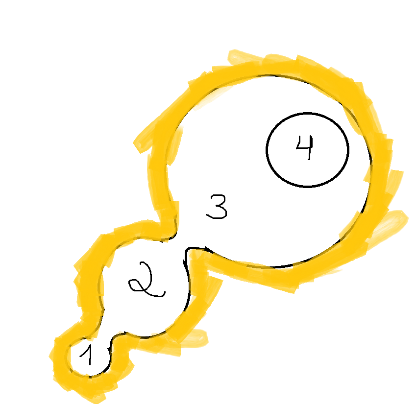

# Anteater Simulator: documento do jogo (consolidado)

Este documento junta, em um lugar só, tudo o que já foi definido sobre o jogo:

- o **documento de design** original (antes no README da `main`);
- o **plano de produção** ([`docs/PLANO.md`](PLANO.md));
- o **protótipo 2D do loop** (pasta [`prototipos/m1-loop/`](../prototipos/m1-loop/));
- a **demo 3D** (o projeto principal deste repositório) e as escolhas feitas na
  conversa em que ela foi criada;
- as **decisões de 02/11/2026**, tomadas para resolver o que não batia;
- as **mudanças pedidas depois do primeiro e do segundo teste** da demo (também
  de 02/11/2026) e as rodadas seguintes (interface, mensagens, mapa, 32 000
  formigas e a rainha, de 03 a 05/11/2026).

Quando algo aqui contradiz uma fonte antiga, **vale este documento**.

---

## 1. O jogo em poucas palavras

Um jogo **relaxante de "arrumar e limpar"**. Você é um **tamanduá-bandeira**
que come **formigas e cupins** no **cerrado**, evolui habilidades e deixa a
região **100% limpa**. Aí o jogo acaba: não existe loop infinito e não dá para
perder.

**A história:** o tamanduá acorda numa caverna e vê, lá longe, um **cupinzeiro
gigante**. A barriga ronca: ele quer comer e chegar até lá. O caminho passa por
4 áreas do cerrado (seção 3).

**Para PC (Steam)**, por **até R$ 20**, em **3D estilizado** com cara de filme
de animação, visto **pelos olhos do tamanduá**.

### Inspirações

As principais são ***Leaf it Alone*** e ***Librarian: Tidy Up the Arcane
Library***. O documento original também cita *Supermarket Chaos*. O que
buscamos, no espírito delas:

- uma tarefa simples que dá prazer de repetir;
- progresso sempre visível: dá para ver quanto falta limpar;
- sem pressa e sem punição;
- um fim claro, quando tudo está limpo;
- melhorias que deixam a tarefa mais gostosa, não só mais rápida.

---

## 2. O que já existe

| | O que é | Onde está | Situação |
|---|---|---|---|
| **Documento de design** | As regras e ideias do jogo inteiro | Seção 6 deste documento | Consolidado aqui |
| **Plano de produção** | Etapas de M1 a M5, riscos e cortes sugeridos | [`docs/PLANO.md`](PLANO.md) (resumo na seção 7) | Escrito |
| **Protótipo M1 (2D)** | Testa só a sensação de comer: 1 ninho com 6 câmaras, 259 insetos e a rainha. Gráfico simples de propósito | Pasta [`prototipos/m1-loop/`](../prototipos/m1-loop/), um projeto Godot à parte (detalhes na seção 8) | Jogável |
| **Esboço do mapa** | As 4 áreas do jogo completo, cercadas por penhascos | Seção 3 ([`esboco-mapa.png`](esboco-mapa.png)) | Base para o formato, que pode mudar |
| **Demo 3D** | A área 1 (uma clareira do cerrado, sempre no fim da tarde), em 1ª pessoa: começa numa caverna, cercada por penhascos, com o cupinzeiro gigante lá longe; 44 000 insetos (cada um sozinho, um quarto passeando pelo campo), 18 formigueiros e 116 câmaras (48 no meio do campo), rainhas no fundo dos montes grandes, 5 habilidades (40 níveis), mapa no TAB, jogo salvo e um tronco caído que fecha a saída | Projeto principal, na raiz do repositório (detalhes na seção 8) | Jogável, já seguindo as decisões (seção 4) |

---

## 3. O jogo, como está decidido

### Plataforma, preço, visual e câmera

- **PC primeiro, na Steam.** Mouse e teclado, e também controle. Celular pode
  vir depois.
- **Preço:** no máximo **R$ 20**.
- **3D estilizado**, com cara de filme de animação. Nada de pixel art, nada de
  low poly.
- **1ª pessoa:** você vê o mundo pelos olhos do tamanduá, com o focinho na parte
  de baixo da tela. Os olhos ficam a **72 cm do chão**, e dá para **subir nos
  formigueiros** para olhar dentro das câmaras. Correndo, a câmera balança de
  leve (dá para desligar). *Atenção (do plano): câmera livre deixa a criação das
  fases mais cara do que câmera fixa.*
- **Tela:** janela, tela cheia ou tela cheia exclusiva, em várias resoluções, e
  opções gráficas separadas (sombras, capim, suavização, efeitos de luz).
- **Interface no estilo "Constelação"**, o mesmo da árvore de habilidades
  (escolhido entre 5 estilos em 03/11/2026):
  - painéis quase pretos com moldura dourada dupla e losangos de enfeite;
  - textos em **Alegreya Sans**; números e títulos em **Alegreya SC**, com
    algarismos alinhados (as duas fontes são gratuitas, licença OFL);
  - as formigas comidas ficam num **medalhão** redondo, como o centro da árvore;
  - as habilidades da barra de baixo são **círculos**, como os da árvore;
  - a **bússola** é uma faixa com moldura dourada, risquinhos a cada 15° e um
    medalhão no meio com o rumo. Os formigueiros são montinhos em cima da faixa;
    só o que está à sua frente mostra nome e distância, então os números não se
    embolam.
- **Modelos 3D gerados por IA**, todos no mesmo estilo. Os prompts estão em
  [`prompts-ia.md`](prompts-ia.md). O formigueiro já foi gerado na Artlist e
  falta baixar (precisa de um plano com créditos).
- **Motor:** Godot 4.7.

### Tamanho e mapa

- **Um mapa só, todo no cerrado, com 4 áreas** ligadas por passagens estreitas
  e cercado por **penhascos**, que são o limite do mapa. Você anda de uma área
  para a outra sem telas de carregamento. O formato do esboço (abaixo) é uma
  base e pode mudar com o tempo.
- O cerrado é a savana brasileira (a "Savana" do documento original). As árvores
  vão ficar um pouco mais densas.
- **A demo é a área 1**, uma **região completa de 45 a 60 minutos**, com **12
  ninhos**: 8 em volta e 4 no meio. Os formigueiros ficaram cerca de 45% maiores.
- **Na área 1, os ninhos são só formigueiros**, de uma formiga que fica só no
  chão, com as câmaras da demo. Os cupinzeiros aparecem apenas como cenário.
- **44 000 insetos** (eram 1000, depois 3200, depois 32 000), cada um andando
  sozinho: **10 insetos comidos = 1 ponto**, 4 400 pontos no jogo inteiro. A
  árvore tem 40 habilidades com **75 cliques** e custa **4 227 pontos** (96%),
  e cada habilidade tem uma **trava**: só abre depois de comer 200, 500, 1 000,
  2 000, 3 000, 5 000, 8 000, 13 000 ou 21 000 insetos (o começo de cada ramo
  abre já, menos o Farejar, com 3 000). As contas estão em
  [`pesquisa-habilidades.md`](pesquisa-habilidades.md), seção 9.

### O mapa: 4 áreas (esboço de 02/11/2026)

| Área | Como é | Insetos | Como se chega |
|---|---|---|---|
| **1** | Uma clareira: onde se passa a demo | Formigas que ficam só no chão, com as câmaras da demo | É o começo: o tamanduá sai de uma caverna |
| **2** | Árvores mais densas | Outro tipo de formiga, que consegue ficar nas árvores | Liberada ao limpar 100% da área 1 |
| **3** | A área grande, em volta do cupinzeiro gigante | Cupins | Depois da área 2 |
| **4** | Um **cupinzeiro gigante**: dá para ir subindo nele e comendo os cupins | Cupins | Dentro da área 3 |

- **A área 4 aparece desde a área 1**, lá longe: é o lugar aonde o tamanduá
  quer chegar.
- **História:** o tamanduá acorda numa caverna, vê o cupinzeiro gigante lá de
  longe, a barriga ronca, e ele decide comer e ir até lá.
- **Foco agora:** a demo (área 1) e o refinamento dela.

### A área 1 (a demo), decidida em 02/11/2026

- **Tamanho:** continua com cerca de 120 m de um lado ao outro. Em volta, no
  lugar da parede invisível, ficam **penhascos de arenito** (faixas creme e
  vermelhas), com muitas árvores no platô lá em cima e algumas no pé deles.
- **Começo:** o tamanduá acorda no fundo de uma **caverna** no pé do penhasco,
  já de frente para o cupinzeiro gigante, e a **barriga ronca** uma vez. Dá para
  jogar logo; um vídeo de abertura fica para depois.
- **O cupinzeiro gigante** aparece lá longe, por cima dos penhascos, no rumo da
  saída. Ele fica dentro do mapa, nas áreas mais adiante. **Não brilha.**
- **Horário fixo:** é sempre o mesmo fim de tarde. O sol não se põe enquanto
  você joga.
- **Saída para a área 2:** uma passagem estreita entre os penhascos, fechada
  por um **tronco caído**. Com a clareira 100% limpa, a bússola mostra a saída;
  perto do tronco, segure **E** e as garras quebram o tronco. Na demo, isso é o
  fim: o caminho até o cupinzeiro fica aberto. Depois do tronco, o chão sobe
  numa rampa até uma **picada que entra numa mata cada vez mais fechada**,
  mostrando que a área 2 é mais densa.
- **Lagoas:** uma ou duas, **só de enfeite** (não têm insetos nem mudam o jogo).
- **A barriga não aponta o caminho:** ela só ronca no começo.
- **Ideia para a área 2:** um nível das **Garras** que deixa **escalar ou
  quebrar a árvore** para comer as formigas que moram nela (a outra opção é a
  Escalada + Cauda).

### Como se come: os dois jeitos juntos

- **Trilhas:** formigas andam pelo mapa entre os ninhos e os arbustos, em
  filas cheias, indo e voltando sem parar. Você lambe as que estão de passagem.
- **Passeios:** mais da metade das formigas soltas sai das câmaras espalhadas
  pelo campo, dá uma volta longa (até uns 12 m) e entra de novo. Elas contam
  para o formigueiro dono da câmara.
- **Ninhos com câmaras:** cada ninho tem câmaras internas. Você cava com as
  Garras e esvazia uma por uma, com a satisfação de terminar de arrumar uma
  prateleira. Ao abrir, as moradoras **saem correndo** e fogem quando você chega
  perto (como as das trilhas). Com a câmara aberta, elas não voltam para ela:
  cada uma vai para um canto da região em volta (4 a 13 m) e fica andando por
  lá; as que ainda estavam no túnel saem e vão direto para o seu canto (no
  buraco da rainha, a corte fica com ela). Tontas, ao acordar perto do
  tamanduá, continuam fugindo de medo. Algumas câmaras
  ficam **sozinhas no meio do campo**, longe das trilhas: o Faro ajuda a achá-las.
- Depois de abrir uma câmara, **as garras descansam** (25 s no começo).
- **Buracos maiores pedem mais Cavar:** o Cavar abre as câmaras pequenas (dos
  formigueiros pequenos e as do campo); a **Fundura nível 1** abre as câmaras
  grandes, dos formigueiros grandes (de tampa mais escura); e a **Fundura
  nível 2** desmancha o monte da rainha.
- **Cada formiga é uma só** (não há grupos): **10 formigas comidas = 1 ponto**.
  A **língua** começa **lenta** (1,4 lambida por segundo), com **um clique por
  lambida**, pegando **uma** formiga. A linha de Destreza a deixa mais rápida
  (até 4,4 lambidas por segundo) e a de Comprimento, mais longa (de 3 m até
  4,5 m). A primeira habilidade (**Lambida Contínua**, 15 pontos)
  deixa segurar o botão; a linha de **Bocado** aumenta quantas vêm de uma vez,
  um pouco a cada clique: 2, 3, 5, 8... até 40 formigas.
- No começo a língua vai **reta** até onde você mira e pega a formiga que
  estiver perto da ponta. A **Mira nível 1** (12 pontos) faz a língua ir
  sozinha atrás da formiga mais perto da mira, e a **Mira nível 2** deixa
  essa área maior a cada clique.
- **O fim:** a região está limpa quando não sobra nenhum inseto, nem nas trilhas
  nem dentro dos ninhos.

### Desafio extra: rainha e tanajura

- **Rainha:** aparece **só nos ninhos grandes** e mora **bem no fundo**: com
  **Fundura nível 2** (Garras), cavar o topo do monte o desmancha inteiro, e fica um
  **buraco** com a rainha andando devagar lá embaixo, junto com a corte e as
  moradoras das outras câmaras do monte. Só dá para comê-la depois de comer a
  corte. Vale **200 formigas (20 pontos)** e tem
  efeito e som próprios. O Faro Lendário marca as rainhas na bússola.
- **Tanajura:** rainha voadora e rara que cruza o mapa. Comê-la deixa a língua
  mais rápida por alguns segundos.
- **Sem insetos resistentes:** as formigas-soldado saíram da demo.

### Habilidades: as 5 do plano

**Cada 10 formigas comidas valem 1 ponto** (a rainha vale 200 formigas), e
**cada habilidade tem o seu preço**. Você escolhe onde gastar, e os gestos novos (segurar para lamber,
lambida, cavar, escalar) também são comprados assim. Dá para redistribuir os
pontos de graça.

Cada ramo começa com uma habilidade e depois se divide em **linhas que não se
excluem** (dá para seguir todas): duas no Faro e quatro na Língua, nas Garras
e nas Patas.

**A árvore tem cara de constelação**, inspirada na árvore passiva de Path of
Exile (só no visual, sem aquele tamanho todo): os 5 ramos saem do centro, onde
ficam os pontos; cada habilidade é um círculo com ícone e preço, as aprendidas
acendem em dourado e as que já dá para aprender pulsam. O nome e o que cada uma
faz aparecem ao passar o mouse (ou o controle). Ela **não abre sozinha**: quando
dá para aprender algo, um selo no canto da tela mostra quantas (◆ 2 **Tab**). O
**TAB** abre primeiro o **mapa**; a árvore fica na aba ao lado.

Cada habilidade tem de **1 a 3 cliques**, mostrados com bolinhas em volta do
círculo (●●○). Cada clique é uma melhora pequena, com o seu preço; a próxima
habilidade da linha só abre com todos os cliques da anterior (e a trava dela
aberta). Entre parênteses: o preço de cada clique e a trava em insetos comidos.

| Habilidade | Linha | Níveis (preço de cada clique · trava em insetos comidos) |
|---|---|---|
| **Língua** | começo | Lambida Contínua (15: segurar para lamber) |
| | Bocado | nível 1 (8, 12, 16 · 200: 2 → 3 → 5 insetos por lambida) · nível 2 (30, 40, 50 · 2 mil: 8 → 11 → 15, e a ponta gruda num raio maior) · nível 3 (70, 90 · 8 mil: 20 → 25) · nível 4 (160, 200 · 21 mil: 32 → 40) |
| | Destreza | só a velocidade: nível 1 (10, 14, 18 · 500: 1,6 → 1,8 → 2 lambidas por segundo; eram 1,4) · nível 2 (50, 60, 70 · 5 mil: 2,4 → 2,8 → 3,2) · nível 3 (260 · 21 mil: 4,4) |
| | Comprimento | só o alcance: nível 1 (16, 20, 24 · 1 mil: 3,3 → 3,6 → 3,9 m; era 3) · nível 2 (60, 80 · 8 mil: 4,2 → 4,5 m) |
| | Mira | nível 1 (12 · 200: a língua vai atrás do inseto mais perto da mira, sem ela vai reta; área da mira de 10° para 15°) · nível 2 (25, 30, 35 · 3 mil: 18° → 21° → 25°) · nível 3 (110 · 13 mil: a ponta gruda num raio 70% maior) |
| **Garras** | começo | Cavar (25: abre as câmaras pequenas; depois as garras descansam 25 s) |
| | Força | nível 1 (25, 35 · 2 mil: moradoras tontas por 1,5 → 2,5 s ao abrir) · nível 2 (40, 50 · 8 mil: 3,2 → 4 s) |
| | Tremor (sai de Força nível 1) | nível 1 (90 · 5 mil: libera o Tremor, pulo com pancada; recarga de 21 s) · nível 2 (45, 55, 65 · 13 mil: recarga de 18 → 15 → 12 s) · nível 3 (300 · 21 mil: Terremoto: pulo mais alto, tremor maior, puxa as tontas, recarga de 7 s) |
| | Rapidez | nível 1 (12, 16, 20 · 1 mil: descanso de 20 → 16 → 12 s) · nível 2 (40, 50, 60 · 8 mil: 9 → 7 → 5 s; no último clique, cava na metade do tempo) |
| | Fundura | nível 1 (60 · 3 mil: abre as câmaras grandes) · nível 2 (120 · 13 mil: desmancha o monte da rainha) |
| **Patas** | começo | Fôlego (10: estamina máxima de 50 para 75). Correr existe desde o começo (+25% de velocidade; correndo não dá para lamber) |
| | Corrida | nível 1 (25, 35 · 2 mil: +10% e mais 10% de velocidade correndo) · nível 2 (90 · 13 mil: lamber correndo) · nível 3 (250 · 21 mil: correr não assusta) |
| | Respiro | nível 1 (8, 12 · 200: a estamina volta 4 → 5 por segundo; eram 3) · nível 2 (30, 40 · 3 mil: 6 → 7) |
| | Passada | nível 1 (8, 12, 16 · 500: correndo gasta 9 → 8 → 7 por segundo; eram 10) · nível 2 (40, 50 · 5 mil: 6 → 5) |
| | Fôlego | nível 1 (12, 16, 20 · 1 mil: 100 → 125 → 150) · nível 2 (50, 60 · 13 mil: 175 → 200) |
| **Faro** | começo | Farejar (25 · 3 mil: diz quantos insetos há a até 10 m, até 100 deles, e a distância do mais perto; a bússola aponta o maior grupo) |
| | Alcance | nível 1 (15, 20, 25 · 3 mil: 13 → 16 → 20 m; 160 → 250 → 400 insetos) · nível 2 (55, 70 · 8 mil: 26 → 34 m; 600 → 1000; no último clique, quanto falta em cada formigueiro) · nível 3 (220 · 21 mil: 50 m, 2000, e as rainhas). Cada clique também recarrega mais rápido (10 s → 6 s) |
| | Precisão | nível 1 (45 · 5 mil: nuvem borrada onde estão) · nível 2 (75 · 8 mil: os insetos brilham nítidos) · nível 3 (200 · 13 mil: colunas de cheiro nas câmaras fechadas) |
| **Escalada + Cauda** | | Escalada (300) · Cauda Preênsil (400): ainda não feitas, aparecem com cadeado |

**Habilidades por região:** a **Escalada + Cauda** aparece na árvore desde o
começo, com um cadeado, e só vai poder ser comprada **quando você chegar à
floresta**, onde ela é usada.

**Fora por enquanto:** Camuflagem (repete o que a Língua já faz) e Natação. O
**Focinho** volta junto com o Quintal urbano.

---

## 4. A demo hoje (atualizada em 05/11/2026)

Feito, seguindo as decisões:

1. **18 formigueiros** espalhados pelo mapa inteiro (8 no anel de fora, 4 no
   meio e 6 nos vãos), com **68 câmaras fechadas**, e mais **48 câmaras
   sozinhas no meio do campo**, longe das trilhas e espalhadas por igual (cada
   uma conta para o formigueiro mais perto, no máximo 3 por formigueiro). Os
   **11 pequenos**, sem rainha, ficam do lado da caverna (o começo) e o Cavar já
   abre todas as câmaras deles; os **7 grandes**, com a rainha, ficam do lado da
   saída para a área 2. Segurando **E** com a habilidade Cavar, a câmara abre e as moradoras
   **saem correndo**; elas fogem quando você chega perto e depois voltam para
   casa. Até 40 ficam à vista (120 no buraco da rainha); as outras saem do
   túnel conforme você come. Depois de cavar, as garras descansam. As câmaras
   grandes, de tampa mais escura, pedem **Fundura nível 1**.
2. **Dá para subir nos formigueiros** e olhar dentro das câmaras lá de cima.
3. **Rainha** no fundo dos 7 formigueiros grandes: a tampa dela fica no topo do
   monte, e só **Fundura nível 2** (Garras) a abre. Aí o **monte inteiro some** e fica
   um buraco escuro com a rainha andando devagar no fundo, junto com a corte e
   as moradoras das outras câmaras do monte. A rainha brilha de leve, fica
   protegida enquanto houver formigas no buraco e **vale 200 formigas (20
   pontos)**.
4. **Os 44 000 insetos andam um a um** (42 600 operárias + 7 rainhas × 200),
   e cada inseto comido conta 1: 25% vão e voltam pelas trilhas, 25%
   passeiam em volta das câmaras do campo (saem, dão uma volta de até 5 m e
   entram de novo) e a metade mora nas câmaras. Para caber tanta formiga, a
   placa de vídeo calcula onde está cada uma das que andam pelas trilhas e pelo
   campo, com 5 níveis de detalhe conforme a distância (4, 9,5, 22 e 40 m). As
   malhas detalhadas de perto só recebem as formigas que estão perto, e a
   sombra delas usa uma malha simples: na mesma cena, a placa de vídeo passou
   de 33,5 para 7,6 milhões de triângulos por quadro. As moradoras das câmaras
   só existem como um número até a câmara abrir; quando uma precisa de
   atenção (fugir, ficar tonta, ir para a língua ou para a mira), o jogo passa a
   cuidar dela, e depois ela volta para o caminho dela. Uma formiga em cada
   16 000 usa um **chapéu de Natal**.
5. **Soldados:** saíram. A **tanajura** continua.
6. **As 5 habilidades, com 40 níveis e 75 cliques**, cada clique com seu preço (seção 3), numa
   árvore com **cara de constelação** que não abre sozinha. A língua começa
   **lenta** (1,4 lambida por segundo, acelerando com a linha de Destreza), com
   um clique por lambida, e vai **reta** até aprender a Mira nível 1; correndo
   não dá para lamber até aprender Corrida nível 2. Farejar também precisa ser
   aprendido. O **Tremor** é um pulo: a pancada vem ao cair. A **Escalada +
   Cauda** aparece com cadeado. Dá para **redistribuir os pontos**.
7. **Progresso visível, com pouco texto:** no canto, as formigas comidas, os
   pontos com o ícone e o preço da próxima habilidade e um losango por
   formigueiro limpo; **cartões** no canto direito para câmara limpa (com as
   câmaras do formigueiro), formigueiro limpo, rainha, Frenesi (com a barra do
   tempo) e habilidade aprendida, que se juntam (×2, ×3); e florzinhas no
   formigueiro quando ele fica limpo. A bússola mostra só a distância e as
   câmaras do formigueiro à frente (sem nomes) e o marcador do mapa, com a distância. Não há relógio na tela, a não ser no modo contra o relógio. O Faro mostra, conforme os níveis, quantas formigas
   há (num selo em cima do botão de Farejar), uma nuvem onde elas estão, as
   formigas brilhando e as câmaras fechadas; o Faro Aguçado mostra na bússola
   quanto falta em cada formigueiro e o Faro Lendário marca as rainhas. Salvar
   aparece só como um ícone girando no canto.
8. **Jogo salvo:** salva sozinho a cada 30 s, ao pausar e ao sair, em até **3
   jogos salvos**. **Continuar** abre o mais recente; **Jogos salvos** mostra os
   três (insetos comidos, tempo, data) e deixa apagar um (com confirmação).
   Jogos salvos de versões com outro mapa não são carregados (o de 12
   formigueiros também não).
9. **Configurações** em abas (Tela, Gráficos, Jogo, Controles, Áudio): janela,
   tela cheia ou tela cheia exclusiva, resolução, resolução do 3D, VSync, limite
   de FPS, sombras, capim, suavização, efeitos de luz, balanço da câmera, **cor
   do faro** (vermelho, ciano, magenta ou branco), **Dicas** (Todas, Poucas ou
   Nenhuma), sensibilidade do controle, **mostrar a interface (HUD)**, **trocar
   as teclas**, Correr e Cavar como segurar ou apertar uma vez, e volumes de
   música, efeitos e ambiente. **F11** ou **Alt+Enter** alternam a tela cheia;
   **F3** mostra o medidor de desempenho (FPS, tempo da placa de vídeo,
   triângulos).
10. **Pausa de verdade:** na pausa e na árvore de habilidades, as formigas
   param.
11. **Penhascos** em volta da clareira, que são o fim do mapa, com muitas
   árvores no platô, algumas no pé e pedras soltas. As paredes da passagem para
   a área 2 têm topo e frente (de lado elas pareciam uma lâmina fina), e as
   copas das árvores não têm mais o miolo escuro que parecia um ninho no galho.
12. **Começo na caverna:** o tamanduá acorda numa caverna no pé do penhasco,
   olhando para o **cupinzeiro gigante** lá longe, e a barriga ronca. Uma
   **trilha de terra**, sem capim, leva da caverna até o formigueiro mais perto
   (um formigueiro pequeno). O cupinzeiro gigante pega a mesma névoa e a mesma luz
   do resto do cenário.
13. **Fim da demo:** a passagem para a área 2 fica fechada por um **tronco
   caído**. Com 100% limpo, a bússola mostra a saída; segurando **E** perto do
   tronco, as garras quebram o tronco e a demo termina. Pela passagem dá para
   ver a rampa que sobe para a **mata fechada** da área 2.
14. **Sempre o mesmo fim de tarde** (o sol não se põe mais) e **quatro lagoas**
   de enfeite, de formas irregulares (cada uma junta 3 a 5 círculos), de tamanhos
   diferentes e espalhadas sem simetria. Olhando para o sol, a névoa fica
   quente em vez de branca.
15. **Interface nova, no estilo Constelação:** HUD, menus, pausa, configurações e
   árvore com a mesma cara (moldura dourada, Alegreya SC e Alegreya Sans), e a
   bússola em faixa com medalhão (seção 3).
16. **Dicas curtas embaixo da mira**, com a tecla num quadradinho e poucas
   palavras (ou só ícone e número): "E Abrir câmara", o relógio das garras,
   o cadeado com a habilidade que falta e a aba (o Tab abre a aba de
   habilidades já mostrando essa habilidade), a coroa com quantas faltam no
   buraco da rainha. Com Dicas: Todas, os controles (andar, correr, TAB) aparecem em cima
   das habilidades até você usar cada um.
17. **Mapa no TAB** (abre primeiro; Q e E trocam para a árvore): o mapa
   inteiro, centrado, com a saída para cima e para a direita. A clareira fica
   colorida onde você já andou e escura no resto; as áreas 2, 3 e 4 aparecem
   pretas, com cadeado. A roda do mouse aproxima (do mapa inteiro até a
   clareira) e arrastar move. Mostra os formigueiros limpos, começados (com as
   câmaras) e não visitados; câmaras do campo que você já viu ou farejou; a
   caverna e você. Passar o mouse num formigueiro clareia de leve a área dele.
   A legenda à direita é curta (Formigueiros, Câmaras, Caverna, Jogador,
   Fechada, Insetos, Marcador). Cada formigueiro já visto mostra quantos
   insetos faltam nele. Clique direito (ou Y no controle) põe um marcador, que
   aparece na bússola. O que foi explorado e o marcador vão no jogo salvo.
18. **Estatísticas** (um botão na pausa abre a tela delas; também aparecem na tela do fim): os números deste jogo, as ações
   (linguadas e acerto, faro, tremores, distância, tempo correndo), as parciais
   do contra o relógio e os recordes de todos os jogos.
19. **Contra o relógio:** escolhido ao começar um jogo novo. Cronômetro com
   décimos no canto, parcial a cada 25% dos insetos comparada com a do recorde,
   e um recorde só desse modo. O relógio só corre com o jogo rodando.
20. **Conquistas preparadas** (21, em `scripts/achievements.gd`): contadas, mas
   escondidas na demo; prontas para a Steam ou para um menu próprio.
21. **Leitura melhor:** nomes das habilidades com contorno escuro, habilidade
   bloqueada em cinza claro, o capim some perto da câmera (não tampa as
   formigas), a formiga que a língua vai buscar tem um contorno verde suave, a
   árvore mostra os números de antes → depois, e a tanajura zumbe baixinho
   quando está perto. Nos textos, "formigas" virou **"insetos"** onde vale para
   formigas e cupins.

Ainda a ajustar:

- **Duração:** a meta é de 45 a 60 minutos, e ela vai ser medida jogando (sem
  o robô de testes). Como referência: num teste automático da segunda rodada, um
  robô de mira perfeita terminou a colônia (então com 3200 formigas) em cerca
  de 19 minutos.
- **Desempenho:** a medição de 07/11/2026 (servidor sem placa de vídeo, que
  conta o que é desenhado) mostrou onde ia o trabalho e levou às mudanças da
  tabela do histórico. Falta medir num PC de verdade com o medidor do jogo
  (**F3**).
- **Economia das habilidades:** a pesquisa de 05/11/2026
  ([`pesquisa-habilidades.md`](pesquisa-habilidades.md)) mediu com o bot o
  tempo de cada compra (seção 5): o bot limpa a clareira em 81–84 minutos, com
  uma hora de ritmo parado e uma explosão nos últimos 15 minutos. A
  reformulação já foi feita (estamina, travas, preços novos, Tremor e rainha
  mais cedo). Com ela, o bot limpou a clareira em 68–73 minutos e comprou a
  última habilidade com 87% dos insetos; o ritmo ainda fica parado dos 20 aos
  40 minutos e acelera muito no fim (seção 8 da pesquisa).

---

## 5. Ainda em aberto

- **O vídeo de abertura:** o tamanduá acordando na caverna (fica para depois).
- **A formiga das árvores (área 2):** que espécie é, e qual habilidade leva até
  ela: a Escalada + Cauda ou um nível das Garras que escala ou quebra a árvore.
- **Os cupins (áreas 3 e 4):** como são os ninhos (câmaras, rainha?) e como é
  subir no cupinzeiro gigante.
- **A "outra floresta":** era a ideia anterior para depois do Cerrado. Com o
  mapa todo no cerrado, fica de fora? (As lagoas já entraram, só de enfeite.)
- **Quintal urbano:** quando entra, e se o Focinho volta com ele.

---

## 6. Documento de design original (referência)

Como estava no README da `main`. Onde ele contradiz a seção 3, vale a seção 3.

### Escopo

- **Duração:** 3 a 5 horas para fazer 100%, para um jogador comum.
- **Regiões:** Savana, Floresta e Quintal urbano.
- **Ninhos:** 8 a 10 por região (~27 no total), de 3 a 6 minutos cada (~90 a
  160 minutos só comendo, sobrando tempo para andar e usar habilidades).
- **Insetos:** ~800 a 1.200 no jogo inteiro, aumentando de ninho para ninho.
- **Sem loop infinito:** mapa 100% limpo = fim, como em *Leaf it Alone*.

### Como se come

1. Tocar num inseto: ele é comido na hora, com efeito e som rápidos.
2. A língua evoluída libera a **lambida**: arrastar pelo ninho come vários.
   Evoluir vira um **gesto novo**, não só um número subindo.
3. Cada ninho tem **câmaras**; esvaziar uma dá a satisfação de terminar de
   arrumar uma prateleira.

### Regiões e seus ninhos

| Região | Como são os ninhos |
|---|---|
| Savana (Cerrado) | Cupinzeiros em forma de torre |
| Floresta | Formigueiros de folha e ninhos em árvores |
| Quintal urbano | Fendas no cimento |

> A ordem de liberar as regiões (por Faro ou Garras) estava em aberto.

### Habilidades

| Habilidade | Para que serve |
|---|---|
| **Língua** | Come mais rápido; fica mais comprida e grudenta; libera a lambida |
| **Patas** | Anda mais rápido; libera a corrida |
| **Garras** | Abre ninhos maiores e bloqueios; chave para novas regiões |
| **Escalada + Cauda** | Sobe em árvores e se pendura na cauda para alcançar ninhos embaixo de galhos ou do outro lado de um vão |
| **Focinho** | Sonda fendas estreitas que a garra não abre; essencial no Quintal |
| **Camuflagem** | Os insetos reagem menos à sua presença (ficam mais parados); outro caminho, além da Língua, para ficar mais eficiente |
| **Faro** | Ver abaixo |
| **Natação** *(futuro)* | Chave para uma possível 4ª região, como brejo ou beira de rio |

**O Faro em detalhe:** fica mais preciso e alcança mais longe conforme evolui.

- Revela ninhos escondidos, inclusive entradas de novas regiões.
- Mostra a "qualidade" de um ninho antes de você ir até lá (vale a pena ou não).
- Acha insetos esquecidos, em 3 níveis:
  - **Nível 1:** avisa que sobrou algo perto (raio curto, sem direção).
  - **Nível 2:** aponta a área dentro do ninho.
  - **Nível 3:** marca o inseto exato, funciona à distância e avisa até em
    ninhos que pareciam prontos.

### Rainha

- Fica no ponto mais cheio do ninho, coberta por outros insetos.
- Só dá para comê-la depois de limpar tudo em volta.
- Vale **15 a 20 vezes** um inseto comum, com efeito e som próprios.
- O Faro nível 3 ajuda a encontrá-la.

### Descartado

- Ninhos que os vizinhos "retomam" (iria contra um jogo curto e com fim).
- Insetos mais fortes ou resistentes (a rainha já é o desafio extra).

---

## 7. Plano de produção (resumo)

O plano completo está em [`docs/PLANO.md`](PLANO.md).

**A pergunta que vem antes de tudo:** comer um inseto é gostoso o bastante para
sustentar o jogo inteiro? O protótipo 2D existe só para responder isso: jogue
até o fim e depois veja 3 pessoas jogando, sem falar nada.

| Tempo para limpar o ninho do protótipo | O que significa |
|---|---|
| 3 a 6 min | O número de insetos está certo |
| Mais de 8 min | Ninho grande demais ou lambida lenta (cortar insetos antes de cortar ninhos) |
| Menos de 2 min | Cabe mais conteúdo por ninho, ou o mapa pode ter menos ninhos |

Anote também **quando a lambida foi liberada** e se aquilo foi um alívio: é o
teste da melhor ideia do documento (evoluir vira gesto novo).

**Riscos apontados**

1. **Repetição:** só **Escalada + Cauda** (e o Focinho, no Quintal) mudam o
   gesto de verdade. São as mais caras e as mais importantes.
2. **Camuflagem repetida:** cortada (decisão de 02/11).
3. **Caçar os últimos 5%:** procurar o último inseto pode ser chato. O Faro
   resolve, mas não pode entregar tudo cedo demais.

**Corte que o plano sugeria** (antes das decisões de 02/11): 2 regiões
(Savana e Floresta, ~16 ninhos), Quintal como atualização depois do lançamento,
sem Natação e sem Camuflagem, e 5 habilidades. Para a ordem das regiões, a
sugestão era Savana → Floresta (com Garras + Escalada) → Quintal (com Focinho).
Também recomendava lançar a página na Steam **antes** da segunda região.

**Etapas**

| Etapa | Objetivo | Pronto quando... |
|---|---|---|
| **M1: Sensação** | Protótipo do ato de comer | Você e mais 2 pessoas quiseram terminar o ninho |
| **M2: Fatia vertical** | Um ninho no visual final, câmera de verdade, andar entre dois ninhos, um upgrade, salvar o jogo | Um vídeo de 15 s que dá vontade de jogar |
| **M3: Uma região inteira** | Cerrado completo: todos os ninhos da região e a árvore de habilidades | 45 a 60 min de jogo sem problemas de progressão |
| **M4: Página na Steam + demo** | Medir interesse (lista de desejos) antes da próxima região | Página no ar com demo |
| **M5: Próxima região + lançamento** | Polimento e lançamento | Jogo lançado |

**Onde estamos:** a demo 3D já cobre a M2 (visual final, câmera de verdade,
andar entre ninhos, habilidades e jogo salvo) e boa parte da M3 (o Cerrado com
18 formigueiros e a árvore de habilidades). Falta acertar a duração com testes.

---

## 8. As versões jogáveis

### Protótipo M1 (2D), pasta `prototipos/m1-loop/`

- **Como abrir:** é um projeto separado da demo 3D. No Godot, clique em
  **Importar** e escolha o `project.godot` de dentro de `prototipos/m1-loop/`.
  Testado no Godot 4.7, jogado do começo ao fim.
- **Clique:** come 1 inseto. **Segurar e arrastar:** lambida. **F:** Faro.
  **R:** recomeça.
- **Ninho:** 6 câmaras com 259 insetos. A câmara do topo é a mais cheia e guarda
  a rainha, atrás de um bloqueio de terra que as Garras quebram.
- **Evolução automática** pelo total comido: Faro I (25), Lambida (50),
  Faro II (100), Garras (150), Faro III (175), Língua III (185).
- No fim, mostra **insetos por minuto** e o **tempo total**.

### Demo 3D, projeto principal

- **1ª pessoa** numa clareira do cerrado, sempre no mesmo fim de tarde, cercada
  por **penhascos**. Começa numa **caverna**, de frente para o **cupinzeiro
  gigante** lá longe, e termina quebrando o **tronco caído** que fecha a saída.
- **18 formigueiros** (7 com rainha) e **116 câmaras** para abrir e esvaziar (48
  delas no meio do campo); dá para subir nos montes. As formigas das câmaras
  saem correndo quando você abre.
- **44 000 insetos**, cada um sozinho, andando pelas **trilhas** até os
  arbustos e passeando em volta das câmaras do campo. Correr assusta as
  formigas.
- **Língua** que estica até onde você mira; **Faro** que mostra as formigas
  através do capim; **tremor** que deixa as formigas tontas.
- **Tanajura** voadora que dá o Frenesi.
- **5 habilidades com 40 níveis**, numa árvore com cara de constelação: 10
  formigas = 1 ponto, cada nível com seu preço, e redistribuição grátis.
- **Mapa no TAB**, colorido onde você já andou.
- **Salva sozinho**; dá para continuar de onde parou.
- **Tela cheia e várias resoluções**, com opções gráficas separadas.

---

## 9. Histórico das decisões

| Data | Assunto | Antes (o que cada fonte dizia) | Decidido |
|---|---|---|---|
| 02/11/2026 | Visual | Plano: 2D ou 3D, decidir na M2 | 3D estilizado, tipo filme de animação |
| 02/11/2026 | Câmera | Plano: considerar câmera fixa | 1ª pessoa |
| 02/11/2026 | Como se come | Documento: ninhos com câmaras. Demo: trilhas e ondas | Os dois juntos |
| 02/11/2026 | Tamanho | Documento: 3 regiões. Plano: 2 | Só o Cerrado por enquanto |
| 02/11/2026 | Duração do Cerrado | Plano: 45 a 60 min. Demo: 6 a 10 min | 45 a 60 min, com 8 ninhos |
| 02/11/2026 | Plataforma | Documento: tocar e arrastar. Plano: Steam | PC (Steam) primeiro |
| 02/11/2026 | Desafio extra | Documento: só a rainha. Demo: soldados e tanajura | Rainha nos ninhos grandes + tanajura; sem soldados |
| 02/11/2026 | Habilidades | Documento: 8. Plano: 5. Demo: 3 ramos | As 5 do plano |
| 02/11/2026 | Como evoluir | Protótipo: marcos automáticos. Demo: pontos | Pontos para escolher |
| 02/11/2026 | Ninhos do Cerrado | Documento: cupinzeiros-torre. Demo: formigueiros | Só formigueiros (cupinzeiros só como cenário) |
| 02/11/2026 | Quantidade de insetos | Documento: ~800 a 1.200 no jogo todo. Demo: 1000 numa fase | 1000 por enquanto |
| 02/11/2026 | Preço | Plano: pesquisar quanto cobram os similares | Até R$ 20 |
| 02/11/2026 | Depois do Cerrado | Documento: Floresta (formigueiros de folha, ninhos em árvores) e Quintal | Outra floresta, com lagoas e cupinzeiros |
| 02/11/2026 | Inspirações | Documento: Leaf it Alone, Librarian e Supermarket Chaos | Principais: Leaf it Alone e Librarian |
| 02/11/2026 | Mapa | Documento: regiões separadas | Um mapa só, com várias regiões |
| 02/11/2026 | Escalada + Cauda | Sem uso no Cerrado (ninhos só no chão) | Só pode ser comprada ao chegar à floresta |
| 02/11/2026 | Lagoas da floresta | Poderiam trazer a Natação | Só cenário por enquanto |
| 02/11/2026 | Organização do repositório | Demo 3D num PR; protótipo e plano numa branch à parte | Tudo junto na `main`; as outras branches foram apagadas |
| 02/11/2026 | Altura da visão | Olhos a 50 cm do chão | 72 cm, e dá para subir nos formigueiros |
| 02/11/2026 | Lamber segurando | Liberado desde o começo | Habilidade inicial de 25 pontos (Lambida Contínua); antes dela, um clique por lambida |
| 02/11/2026 | Preço das habilidades | 1 ponto a cada 100 formigas; tudo custava 1 ponto | 1 formiga = 1 ponto; cada habilidade tem seu preço (25 a 200; Escalada 300 e 400) |
| 02/11/2026 | Garras e Faro | Uma linha de níveis cada | Duas linhas que não se excluem: Força e Rapidez (Garras), Alcance e Fôlego (Faro) |
| 02/11/2026 | Correr | Corrida bem mais rápida; dava para lamber correndo | +25%, e mais 25% com Patas Ligeiras; lamber correndo virou habilidade |
| 02/11/2026 | Quantidade de formigas | 1000 | 3200: dá para aprender tudo (2180 pontos) e ainda jogar com tudo liberado |
| 02/11/2026 | Formigueiros | 8, menores | 12 (4 novos no meio do mapa), cerca de 45% maiores |
| 02/11/2026 | Tela | Janela de 1600x900 e só "tela cheia: sim/não" | Janela, tela cheia ou exclusiva; várias resoluções; opções gráficas separadas |
| 02/11/2026 | Câmera ao correr | Quase parada | Leve balanço de galope (dá para desligar) |
| 02/11/2026 | Farejar | Liberado desde o começo | Habilidade inicial (20 pontos) |
| 02/11/2026 | Alcance do Faro | Em saltos (14, 30, 45 m e o mapa todo) | 4 passos graduais: 10 → 16 → 24 → 34 → 50 m e 10 → 25 → 50 → 100 → 200 formigas |
| 02/11/2026 | Precisão do Faro | As formigas sempre brilhavam | Sem precisão, só conta; Faro Preciso: nuvem borrada; Faro Nítido: formigas brilhando |
| 02/11/2026 | Fôlego do Faro | Linha própria (espera e duração) | Entrou nos níveis de Alcance: cada nível recarrega mais rápido; a linha virou Precisão |
| 02/11/2026 | Faro e câmaras | Só formigas | Faro de Câmara mostra as câmaras fechadas por perto |
| 02/11/2026 | Lambida | Pegava todas as formigas perto da ponta | Linha de Bocado: até 5, 15, 25 e 40 por lambida |
| 02/11/2026 | Cavar | Rapidez reduzia o tempo segurando E | Descanso de 25 s depois de cada câmara; a Rapidez reduz para 15 s e 5 s |
| 02/11/2026 | Tremor | Botão, recarga de 8 s | Pulo com pancada ao cair, recarga de 21 s (14 s e 7 s com as melhorias da Rapidez) |
| 02/11/2026 | Moradoras das câmaras | Ficavam dentro da câmara | Saem correndo ao abrir e fogem quando você chega perto; depois voltam |
| 02/11/2026 | Câmaras no campo | Só nos formigueiros | 12 câmaras no meio do campo, longe das trilhas |
| 02/11/2026 | Cor do faro | Dourada | Vermelha, com opção de ciano, magenta ou branco |
| 02/11/2026 | Aviso de onda | Grande, no meio da tela | Discreto, no painel da direita |
| 02/11/2026 | Pausa | As formigas continuavam andando | Pausa de verdade |
| 02/11/2026 | Habilidades ainda não feitas | Mostravam "na Floresta" | Só um cadeado |
| 02/11/2026 | Mapa do jogo completo | Um mapa com regiões: o Cerrado e depois outra floresta, com lagoas | Um mapa todo de cerrado, com 4 áreas cercadas por penhascos (esboço na seção 3) |
| 02/11/2026 | A demo | O Cerrado inteiro | A área 1, uma clareira; limpar 100% libera a área 2 |
| 02/11/2026 | Insetos por área | Formigas no Cerrado; cupinzeiros só como cenário | Área 1: formigas de chão; área 2: formigas que sobem em árvores; áreas 3 e 4: cupins |
| 02/11/2026 | Objetivo do jogo | Limpar cada região | Chegar ao cupinzeiro gigante (área 4), visível desde a área 1, e subir nele comendo cupins |
| 02/11/2026 | História | Não havia | O tamanduá acorda numa caverna, vê o cupinzeiro gigante e a barriga ronca |
| 02/11/2026 | Horário | O sol se punha conforme você comia | Sempre o mesmo fim de tarde |
| 02/11/2026 | Limite da clareira | Parede invisível | Penhascos de arenito, com árvores no platô |
| 02/11/2026 | Começo da demo | No meio da clareira | Numa caverna no pé do penhasco, de frente para o cupinzeiro gigante; a barriga ronca (o vídeo fica para depois) |
| 02/11/2026 | Cupinzeiro gigante | Não aparecia | Lá longe, por cima dos penhascos, sem brilho |
| 02/11/2026 | Passagem para a área 2 | Em aberto | Fechada por um tronco caído; com 100% limpo, as garras quebram o tronco e a demo termina |
| 02/11/2026 | Lagoas | Só na "outra floresta" | Uma ou duas na clareira, só de enfeite |
| 02/11/2026 | Barriga | Ideia: roncar mais forte na direção certa | Só ronca no começo; não aponta caminho |
| 02/11/2026 | Primeiro caminho | Nenhum | Trilha de terra sem capim da caverna até o formigueiro mais perto |
| 02/11/2026 | Mira da língua | Ajuda de mira desde o começo | A língua vai reta; nova linha de Mira: Língua Certeira (30) e Mira Ampla (60, área 25% maior) |
| 02/11/2026 | Árvore de habilidades | Abria sozinha nos primeiros 25 pontos; caixas em colunas | Não abre sozinha; visual de constelação, inspirado em Path of Exile |
| 03/11/2026 | Estilo da interface | Fredoka, painéis marrons arredondados | Estilo "Constelação" (o mesmo da árvore): moldura dourada dupla, Alegreya SC e Alegreya Sans |
| 03/11/2026 | Bússola | Barra com triângulos e todas as distâncias (os números se embolavam) | Faixa com medalhão do rumo; formigueiros em montinhos; só o da frente mostra nome e distância |
| 04/11/2026 | Mensagens na tela | Avisos de texto no alto da tela, aviso grande para várias coisas, relógio e ondas no canto | Cartões de conquista no canto direito; dicas curtas embaixo da mira; aviso grande só no fim; sem relógio e sem avisar as ondas; salvar vira um ícone |
| 04/11/2026 | Nomes dos formigueiros | "Formigueiro Nordeste", "Sul" etc. na bússola e nos avisos | Sem nomes: a bússola mostra a distância e as câmaras |
| 04/11/2026 | Dicas | Sempre todas | Opção Dicas: Todas, Poucas ou Nenhuma; as de controle somem depois que você usa |
| 04/11/2026 | TAB | Abria a árvore de habilidades | Abre o mapa (colorido onde você já andou), com a árvore na aba ao lado |
| 04/11/2026 | Quantidade de formigas | 3200, 1 formiga = 1 ponto | 32 000, em grupos de 10; 10 formigas = 1 ponto (os preços em pontos não mudaram) |
| 04/11/2026 | Rainha | Na câmara do topo dos formigueiros grandes, aberta pelo Cavar | Numa vala no pé do monte, com a corte; nova linha de Fundura nas Garras: Cavar Fundo (60, câmaras grandes) e Escavação Real (120, a vala) |
| 04/11/2026 | Árvores | Um anel no platô e algumas na clareira | Muito mais árvores no platô e no pé dos penhascos; depois da passagem, rampa e mata fechada (o começo da área 2) |
| 05/11/2026 | Mapa no TAB | Só a clareira, apontando para a esquerda e para baixo | O mapa inteiro, centrado, com a saída para cima e para a direita; áreas 2 a 4 pretas com cadeado; zoom até a clareira; legenda curta, sem porcentagem explorada |
| 05/11/2026 | Aba de habilidades | Textos longos ("Sem ela…", resumo embaixo); explicação podia cobrir a habilidade | Textos curtos; a explicação fica acima ou abaixo (ou ao lado, se couber) e mostra o preço |
| 05/11/2026 | Formigas | 3200 grupos de 10, nas trilhas e nas câmaras | Cada formiga anda sozinha; mais de um terço passeia pelo campo em volta de 36 câmaras (eram 12); as que passeiam contam para o formigueiro dono da câmara |
| 05/11/2026 | Rainha | Numa vala no pé do monte | No fundo do monte: a Escavação Real desmancha o monte inteiro e fica um buraco com a rainha (que anda devagar) e as moradoras do monte |
| 05/11/2026 | Câmaras grandes | Tampa da mesma cor das pequenas | Tampa mais escura, entre a das pequenas e a cor do monte |
| 05/11/2026 | Formigueiros grandes | Espalhados | Do lado da saída; perto da caverna só os pequenos, que o Cavar já abre |
| 05/11/2026 | Velocidade da língua | 3,2 lambidas por segundo desde o começo | 1,4 no começo; Língua Comprida e Saliva Grudenta +25% cada, Língua Turbo 2x |
| 05/11/2026 | Chapéu de Natal | Nenhum | Uma formiga em cada 16 000 (0,00625%) usa um chapéu de Natal |
| 05/11/2026 | Formigueiros | 12 (5 com rainha), 36 câmaras no campo; 74% dos insetos soltos | 18 (7 com rainha), espalhados pelo mapa inteiro; 48 câmaras no campo espalhadas por igual; metade dos insetos mora nas câmaras (25% nas trilhas, 25% passeando) |
| 05/11/2026 | Lagoas | Duas, redondas | Quatro, de formas irregulares e tamanhos diferentes, sem simetria |
| 05/11/2026 | Jogos salvos | Um | Até 3, com Continuar (o mais recente) e a tela de Jogos salvos |
| 05/11/2026 | Modo de jogo | Só um | Normal ou Contra o relógio (cronômetro, parciais a cada 25%, recorde próprio) |
| 05/11/2026 | Estatísticas e conquistas | Nenhuma | Estatísticas num botão da pausa (Esc) e na tela do fim (primeiro foram uma aba do TAB); 21 conquistas preparadas, escondidas na demo |
| 05/11/2026 | Controles e acessibilidade | Teclas fixas | Teclas trocáveis; Correr e Cavar segurar ou apertar; esconder o HUD; volumes de efeitos e ambiente; sensibilidade do controle |
| 05/11/2026 | Mapa | Sem números | Insetos que faltam em cada formigueiro e um marcador (que aparece na bússola) |
| 05/11/2026 | Textos | "formigas" | "insetos" onde vale para formigas e cupins |
| 05/11/2026 | Sol | Névoa branca do lado do sol | Névoa mais quente e com menos brilho; halo do sol menor (o longe fica colorido, como em Firewatch) |
| 05/11/2026 | Estatísticas (lugar) | Aba do TAB | Botão "Estatísticas" na pausa, com tela própria, e os mesmos quadros na tela do fim |
| 05/11/2026 | Bot de teste | Comprava numa ordem fixa e só mirava nas formigas soltas | Compra em rodízio entre os ramos e anota cada compra (`--botlog`); vai atrás de todos os insetos, usa Tremor, corrida e Lamber Correndo |
| 05/11/2026 | Quantidade de insetos | 32 000 (3 200 pontos) | 44 000 (4 400 pontos), para caber a árvore nova com estamina; jogos salvos antigos não carregam mais |
| 05/11/2026 | Correr | Só depois da habilidade Corrida (30), sem limite | Desde o começo, com estamina (barra no canto de baixo, à esquerda): começa com 50, gasta 10/s, volta 3/s 1 s depois de parar. Se zerar, volta a correr com 15%. A habilidade Corrida saiu; Patas ganhou as linhas Respiro, Passada e Fôlego |
| 05/11/2026 | Nomes das habilidades | Um nome para cada nível (Lambida Larga, Garras Ágeis, Faro Apurado...) | Linha + nível (Bocado nível 2, Rapidez nível 1, Alcance nível 2); só o começo de cada ramo tem nome (Lambida Contínua, Cavar, Fôlego nível 1, Farejar) |
| 05/11/2026 | Travas e preços | Tudo aberto desde o começo; árvore de 3 215 pontos | Cinco travas por insetos comidos (1 000, 3 000, 8 000, 13 000, 21 000), com cadeado e "8 mil" na árvore e um aviso quando abrem; árvore de 3 825 pontos (87%), com as pontas mais fortes em 21 000 |
| 05/11/2026 | Tremor | Força nível 2; a recarga ficava na Rapidez | Linha própria, saindo de Força nível 1 (Tremor 1 a 3, o 3 é o Terremoto); Força ganhou nível 2 (tontas por 4 s); Rapidez ficou com 2 níveis |
| 06/11/2026 | Versão de teste | Sem estatísticas dos jogadores | Manda as estatísticas de cada partida para um Formulário do Google (com aviso e opção de desligar; sem nome nem e-mail) e guarda uma cópia no computador; "Versão de teste" no canto do menu ([`estatisticas-dos-testes.md`](estatisticas-dos-testes.md)) |
| 06/11/2026 | Insetos por lambida | 10 no começo e 50, 150, 250, 400 com Bocado (sobra de quando as formigas andavam em grupos de 10) | 1 no começo e 5, 15, 25, 40 com Bocado |
| 06/11/2026 | Tanajura | A língua passava por baixo dela (ia até o chão) e ela fugia antes da ponta chegar; zumbido contínuo | A língua para na tanajura que estiver no caminho e vai atrás dela; em vez do zumbido, um bater de asas curto de vez em quando |
| 05/11/2026 | Desempenho | Cada camada de detalhe montava o grupo inteiro | Separação por distância, camada extra de longe e sombra simples (33,5 → 7,6 milhões de triângulos na mesma cena) |
| 06/11/2026 | Textura do chão do cerrado | Mancha lisa marrom-oliva pintada por código, sem relevo; trilha laranja borrada | Duas estampas feitas no Blender (2 m, 2048 px, com relevo): solo com torrões, pedrinhas, folhas, palhas e gravetos; trilha de terra vermelha batida e rachada. As cores antigas continuam dando o tom; na beira da trilha a mistura segue a altura (as pedrinhas ficam por cima). Custo: ~150 → ~138 FPS (RTX 5070, 3440x1440) |
| 06/11/2026 | Textura dos paredões de arenito | Faixas pintadas por vértice e manchas lisas, com manchas verdes no meio da parede | Estampa feita no Blender (4 m, 2048 px, com relevo): camadas horizontais de espessuras diferentes, fendas verticais que dividem em blocos com bordas vivas, buraquinhos e manchas de ferro. As camadas ficam sempre na horizontal e sobem e descem devagar ao longo do paredão; o topo usa a estampa do chão puxada para o verde, e o verde saiu das paredes. As faixas pintadas por vértice continuam por cima. Velocidade igual (≈135 quadros por segundo) |
| 06/11/2026 | Textura das pedras | Cinza liso com líquen amarelo forte por cima, com cara de esponja | A mesma rocha dos paredões (estampa de arenito com camadas mais finas, rachaduras e relevo), um pouco mais apagada, com poucas manchas de líquen claro, mais nas faces de cima. Velocidade praticamente igual (≈131 quadros por segundo) |
| 06/11/2026 | Textura dos cupinzeiros | Laranja saturado e liso, com cara de massinha | Estampa de barro seco feita no Blender (1 m, 1024 px, com relevo): granulado, caneluras verticais da chuva, rachaduras finas e furinhos; cor mais apagada. Usa o mesmo shader dos paredões, que mantém os sulcos sempre em pé. Velocidade igual (≈130 quadros por segundo) |
| 07/11/2026 | Andar | 3,3 m/s | 2,8 m/s (15% mais lento; correr acompanha) |
| 07/11/2026 | Formigas soltas | 25% nas trilhas e 25% passeando até 5,5 m das câmaras do campo | 20% nas trilhas e 35% passeando até 12 m (as moradoras ficam com 45%) |
| 07/11/2026 | Câmara aberta | As moradoras fugiam e voltavam para andar em cima da câmara; as tontas acordavam e voltavam ao normal | Elas se espalham pela região em volta e ficam por lá; as tontas, ao acordar perto do tamanduá, saem fugindo |
| 07/11/2026 | Farejar | Sem Precisão, só um número no canto da tela | A bússola aponta o maior grupo farejado desde o Farejar |
| 07/11/2026 | Árvore de habilidades | O 1º nó do Bocado ficava em cima do 1º do Fôlego | Ramos da Língua e das Patas mais afastados, e os de 4 linhas um pouco mais fechados |
| 07/11/2026 | Desempenho (placa de vídeo) | No Ultra, 4,8–7,7 milhões de triângulos por quadro na imagem e 2,0–2,7 milhões na sombra. As formigas de longe tinham 68–114 triângulos e a malha detalhada (3500) ia até 4 m. As tanajuras usavam sempre a malha detalhada, com sombra. O chão inteiro e os torrões dos formigueiros faziam sombra, e o MSAA 4x pesava 40% do quadro | Formigas com 5 malhas (2 600 / 880 / 220 / 30 / 12 triângulos, trocando a 2,5, 6, 13 e 40 m) e sombras com malhas simples. Tanajuras simples a partir de 9,5 m. Sombra do chão numa grade 4x mais grossa. Torrões sem sombra e só até 35 m. Capim leve nos blocos de longe. Árvores, pedras e montes com versões automáticas para longe, e folhas com mipmaps. Ultra com MSAA 2x + SMAA. Resultado: 1,8–3,1 milhões na imagem e 0,26–0,54 milhão na sombra, e 40–48% menos tempo de desenho na mesma máquina de teste. Medidor no jogo (F3) |
| 07/11/2026 | Árvore de habilidades | 40 habilidades, uma compra cada; cinco travas (1 000 a 21 000 insetos); 3 825 pontos. No 1º teste do Caio, só 3 compras nos primeiros 13 minutos, e pontos sobrando no fim | As mesmas 40, agora com 1 a 3 cliques cada (75 cliques, bolinhas em volta do círculo); nove travas (200, 500, 1 000, 2 000, 3 000, 5 000, 8 000, 13 000 e 21 000); 4 227 pontos (96%). A Língua ganhou a linha de Comprimento (o alcance saiu da Destreza), a Mira ganhou um 3º nível (o raio da ponta, que era da Destreza), e o Farejar só abre com 3 000 insetos |
| 07/11/2026 | Insetos fogem | A 1 m de você parado e 1,9 m andando (a língua alcança 3 m); correndo, ×1,8 | 1 m parado e 2,5 m andando; correndo, ×1,5 (fica perto do que era) |
| 07/11/2026 | Jogos salvos antigos | Abriam com as habilidades compradas | As habilidades mudaram: os pontos voltam, com o aviso "Árvore nova" |
| 07/11/2026 | Textura da casca das árvores | Casca clara e lisa, com manchas borradas | Cortiça grossa em placas compridas e acinzentadas, rachaduras fundas e escuras e manchinhas de líquen, presa a cada galho (as rachaduras seguem os galhos tortos). Feita no Blender (`tools/blender_casca.py`). Velocidade igual (≈183 quadros por segundo) |
